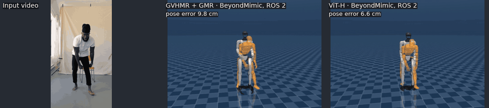
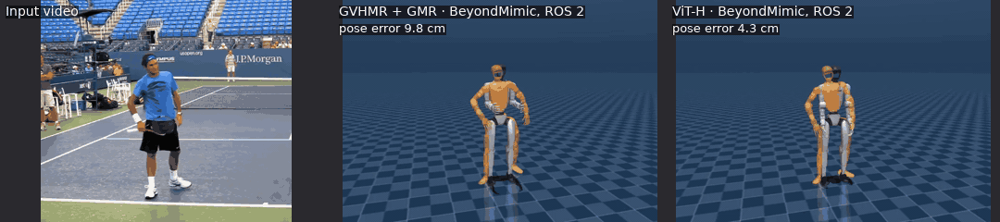
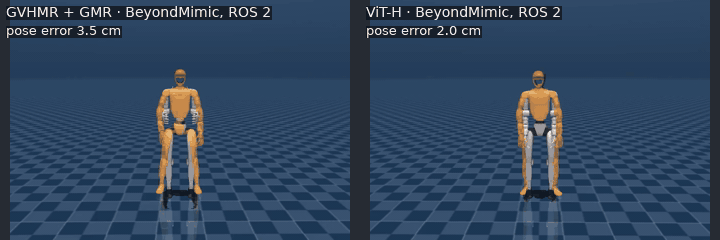
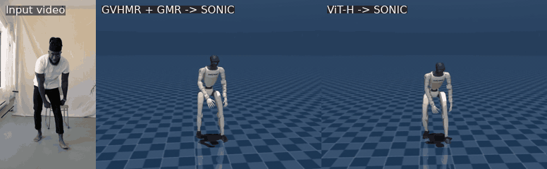
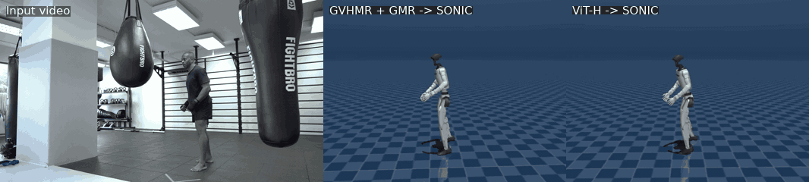

# g1-video2motion

This repo runs BeyondMimic motion-tracking policies for the Unitree G1 in HybridRobotics' ROS 2
deployment stack (in MuJoCo, the same controller as on the real robot) and evaluates them.
The policies are trained on motions made from ordinary videos of people. Two SONIC trackers are scored
on the same motions for comparison.



*Studio dance: BeyondMimic in the ROS 2 deployment stack. Replay of a ROS 2 recording.*

## How it works

1. **Make a motion** (both routes): a video becomes a G1 robot motion, by GVHMR + GMR or by ViT-H
   (3 samples per clip).
2. **Check and ground** (both routes): the motion is checked for joint limits, joint speed and foot
   sliding. If it floats, it is grounded: moved down so the feet touch the floor.
3. **Track and score**, by one of two routes:
   - **BeyondMimic route** (the main tracker):
     - one policy is trained per motion in mjlab and exported to ONNX (the motion is inside the file),
       or the public pretrained LAFAN1 policy is used instead;
     - scored three ways: mjlab's own evaluation, the harness, and HybridRobotics' ROS 2 deployment
       stack (`motion_tracking_controller`, ROS 2 Jazzy) in MuJoCo, recorded and scored.
   - **SONIC route** (for comparison):
     - no training: the motion is converted to SONIC's format and fed to the tracker directly;
     - two trackers: SONIC v1.1 (NVIDIA's release) and SONIC (ViT-H) (ViT-H's fine-tune);
     - scored in the harness only.
4. **Report** (both routes): one script builds [`results/tables.md`](results/tables.md) from all three
   scorers. Videos and GIFs come from harness logs or ROS 2 recordings.

**The harness** is a separate shared tool: our fork of a G1 evaluation harness, cloned into
`third_party/g1-eval-harness`. It scores every tracker on the same robot body (the ROS 2 stack's G1
model), the same physics, 6 conditions and 10 seeds.

## Recommendation

- **Use BeyondMimic.** On these clips it is the most reliable tracker: 1228/1320 harness trials
  succeed, against 995/1320 for SONIC v1.1 and 1096/1320 for SONIC (ViT-H). It is the only one
  that does the jump kick and the only one that finishes the LAFAN1 dance (50/60; both SONIC 0/60).
- **It runs in the ROS 2 deployment stack.** 236/250 scored ROS 2 runs succeed. All 14 failures are
  on the jump kick: 10 are the GVHMR + GMR jump kick, which fails everywhere, and 4 are ViT-H jump kicks.
- **Its price:** one policy per motion (24–33 min of training on one GPU). When it fails, the robot
  really falls (45/1320 trials, all under pushes). SONIC's failures on the video clips leave the robot standing.
- **Prefer ViT-H motions.** They track better than GVHMR + GMR motions with every tracker (BeyondMimic
  965/990 vs 263/330). The main reason: GVHMR + GMR motions float above the floor. ViT-H's 3
  samples of one video can differ a lot, so check each one.
- **Neither method is closer to the real dance.** Against AIST++ motion capture, their body pose errors
  are within about 1 cm of each other.

## Results

Every motion runs in the harness under 6 conditions × 10 seeds = 60 trials: flat ground, low friction,
ice, and three pushes. The jump kick has 30 trials, because it ends before the pushes come.
**Success** = the motion plays to its end without a tracking failure. **r-MPKPE** = pose error on flat
ground. **Real falls** = trials where the robot really ends up on the floor. Exact definitions are in
[Limitations and definitions](#limitations-and-definitions).

Each tracker's harness adapter was first checked against the tracker's own software, so a score
reflects the tracker, not the adapter: BeyondMimic against mjlab and the ROS 2 stack, SONIC v1.1
against NVIDIA's C++ deploy (the same network inputs on every step, within 5e-6), and SONIC (ViT-H)
against ViT-H's own tracker. Details: the harness's
[adapter checks](https://github.com/amirkhonaripov/g1-eval-harness#5-adapter-checks).

ViT-H rows show samples 1 · 2 · 3 of the same video. Full detail per condition, with MPKPE and the
grounded motions: [`results/tables.md`](results/tables.md).

### BeyondMimic

One policy per motion, 3000 iterations. The LAFAN1 dance uses the public pretrained policy.
**mjlab:** mjlab's own evaluation, 1024 episodes. **ROS 2:** the ROS 2 stack, 10 scored runs per policy,
shown as k/n. N in "(N launches)" counts every launch, including the relaunches after
[start-up drops](#start-up-drops-in-the-ros-2-sim).

| Clip | Motion | Success | r-MPKPE (cm) | Real falls | mjlab | ROS 2 |
|---|---|---|---|---|---|---|
| Tennis serve | GVHMR+GMR | 60/60 | 9.3 | 0/60 | 989/1024 | 10/10 (17 launches) |
|  | ViT-H 1 · 2 · 3 | 59/60 · 57/60 · 53/60 | 4.5 · 5.7 · 6.0 | 0/60 · 2/60 · 1/60 | 1023/1024 · 1024/1024 · 1010/1024 | 10/10 · 10/10 · 10/10 (12 · 11 · 16 launches) |
| Studio dance | GVHMR+GMR | 41/60 | 8.0 | 19/60 | 1024/1024 | 10/10 (17 launches) |
|  | ViT-H 1 · 2 · 3 | 57/60 · 59/60 · 60/60 | 4.5 · 5.8 · 4.4 | 3/60 · 1/60 · 0/60 | 1022/1024 · 1024/1024 · 1024/1024 | 10/10 · 10/10 · 10/10 (22 · 15 · 22 launches) |
| Hip-hop (back) | GVHMR+GMR | 52/60 | 12.5 | 0/60 | 1023/1024 | 10/10 (16 launches) |
|  | ViT-H 1 · 2 · 3 | 60/60 · 60/60 · 60/60 | 2.7 · 2.7 · 2.8 | 0/60 · 0/60 · 0/60 | 1023/1024 · 1023/1024 · 1024/1024 | 10/10 · 10/10 · 10/10 (18 · 16 · 12 launches) |
| Pop | GVHMR+GMR | 50/60 | 2.9 | 10/60 | 1024/1024 | 10/10 (16 launches) |
|  | ViT-H 1 · 2 · 3 | 54/60 · 57/60 · 60/60 | 1.7 · 1.8 · 2.8 | 6/60 · 3/60 · 0/60 | 1024/1024 · 1024/1024 · 1023/1024 | 10/10 · 10/10 · 10/10 (13 · 13 · 13 launches) |
| Jazz | GVHMR+GMR | 60/60 | 1.6 | 0/60 | 1024/1024 | 10/10 (18 launches) |
|  | ViT-H 1 · 2 · 3 | 60/60 · 60/60 · 59/60 | 2.0 · 1.8 · 1.9 | 0/60 · 0/60 · 0/60 | 1024/1024 · 1024/1024 · 1024/1024 | 10/10 · 10/10 · 10/10 (19 · 18 · 11 launches) |
| Jump kick | GVHMR+GMR | 0/30 | 7.7 | 0/30 | 0/1024 | 0/10 (14 launches) |
|  | ViT-H 1 · 2 · 3 | 30/30 · 30/30 · 30/30 | 3.4 · 5.1 · 3.5 | 0/30 · 0/30 · 0/30 | 956/1024 · 1011/1024 · 1000/1024 | 9/10 · 8/10 · 9/10 (14 · 11 · 17 launches) |
| LAFAN1 dance | motion capture | 50/60 | 3.5 | 0/60 | 953/1024 | 10/10 (18 launches) |

### SONIC v1.1

NVIDIA's release of SONIC: one tracker for any motion, no training per motion.

| Clip | Motion | Success | r-MPKPE (cm) | Real falls |
|---|---|---|---|---|
| Tennis serve | GVHMR+GMR | 0/60 | 7.4 | 0/60 |
|  | ViT-H 1 · 2 · 3 | 60/60 · 0/60 · 0/60 | 4.5 · 4.1 · 4.8 | 0/60 · 0/60 · 0/60 |
| Studio dance | GVHMR+GMR | 60/60 | 8.3 | 0/60 |
|  | ViT-H 1 · 2 · 3 | 60/60 · 60/60 · 60/60 | 4.5 · 5.4 · 5.0 | 0/60 · 0/60 · 0/60 |
| Hip-hop (back) | GVHMR+GMR | 60/60 | 11.7 | 0/60 |
|  | ViT-H 1 · 2 · 3 | 60/60 · 60/60 · 60/60 | 3.5 · 3.2 · 3.2 | 0/60 · 0/60 · 0/60 |
| Pop | GVHMR+GMR | 60/60 | 3.9 | 0/60 |
|  | ViT-H 1 · 2 · 3 | 60/60 · 60/60 · 35/60 | 3.0 · 2.7 · 3.3 | 0/60 · 0/60 · 0/60 |
| Jazz | GVHMR+GMR | 60/60 | 2.4 | 0/60 |
|  | ViT-H 1 · 2 · 3 | 60/60 · 60/60 · 60/60 | 3.1 · 2.7 · 2.9 | 0/60 · 0/60 · 0/60 |
| Jump kick | GVHMR+GMR | 0/30 | 6.8 | 0/30 |
|  | ViT-H 1 · 2 · 3 | 0/30 · 0/30 · 0/30 | 6.3 · 6.1 · 5.9 | 0/30 · 0/30 · 0/30 |
| LAFAN1 dance | motion capture | 0/60 | 4.1 | 60/60 |

### SONIC (ViT-H)

SONIC fine-tuned by ViT-H's authors on the data ViT-H learns from, shipped with ViT-H.

| Clip | Motion | Success | r-MPKPE (cm) | Real falls |
|---|---|---|---|---|
| Tennis serve | GVHMR+GMR | 0/60 | 6.9 | 0/60 |
|  | ViT-H 1 · 2 · 3 | 59/60 · 34/60 · 44/60 | 4.5 · 5.1 · 5.3 | 0/60 · 0/60 · 0/60 |
| Studio dance | GVHMR+GMR | 60/60 | 7.5 | 0/60 |
|  | ViT-H 1 · 2 · 3 | 60/60 · 60/60 · 60/60 | 3.9 · 5.0 · 4.4 | 0/60 · 0/60 · 0/60 |
| Hip-hop (back) | GVHMR+GMR | 59/60 | 11.9 | 0/60 |
|  | ViT-H 1 · 2 · 3 | 60/60 · 60/60 · 60/60 | 3.2 · 3.0 · 3.1 | 0/60 · 0/60 · 0/60 |
| Pop | GVHMR+GMR | 60/60 | 3.7 | 0/60 |
|  | ViT-H 1 · 2 · 3 | 60/60 · 60/60 · 60/60 | 2.2 · 2.3 · 2.8 | 0/60 · 0/60 · 0/60 |
| Jazz | GVHMR+GMR | 60/60 | 2.0 | 0/60 |
|  | ViT-H 1 · 2 · 3 | 60/60 · 60/60 · 60/60 | 2.9 · 2.7 · 2.7 | 0/60 · 0/60 · 0/60 |
| Jump kick | GVHMR+GMR | 0/30 | 6.4 | 0/30 |
|  | ViT-H 1 · 2 · 3 | 0/30 · 0/30 · 0/30 | 6.1 · 6.0 · 6.2 | 0/30 · 0/30 · 0/30 |
| LAFAN1 dance | motion capture | 0/60 | 4.2 | 60/60 |

### Trackers side by side

Harness success. ViT-H columns add up samples 1–3.

| Clip | BeyondMimic: GVHMR+GMR | BeyondMimic: ViT-H | SONIC v1.1: GVHMR+GMR | SONIC v1.1: ViT-H | SONIC (ViT-H): GVHMR+GMR | SONIC (ViT-H): ViT-H |
|---|---|---|---|---|---|---|
| Tennis serve | 60/60 | 169/180 | 0/60 | 60/180 | 0/60 | 137/180 |
| Studio dance | 41/60 | 176/180 | 60/60 | 180/180 | 60/60 | 180/180 |
| Hip-hop (back) | 52/60 | 180/180 | 60/60 | 180/180 | 59/60 | 180/180 |
| Pop | 50/60 | 171/180 | 60/60 | 155/180 | 60/60 | 180/180 |
| Jazz | 60/60 | 179/180 | 60/60 | 180/180 | 60/60 | 180/180 |
| Jump kick | 0/30 | 90/90 | 0/30 | 0/90 | 0/30 | 0/90 |
| **All six clips** | **263/330** | **965/990** | **240/330** | **755/990** | **239/330** | **857/990** |
| Real falls, all six clips | 29/330 | 16/990 | 0/330 | 0/990 | 0/330 | 0/990 |

- **LAFAN1 dance** (131 s of motion capture): BeyondMimic 50/60. Both SONIC versions 0/60, and the
  robot really falls in every trial (60/60).
- **Runs in the ROS 2 stack:** BeyondMimic only. The stack is built for BeyondMimic policies.
- ViT-H motions have a lower r-MPKPE than GVHMR + GMR motions on 5 of 6 clips, with every tracker.
  Jazz is the exception.
- ViT-H motions go past the G1's joint limits on 0–13% of frames. GVHMR + GMR motions never do
  ([`results/tables.md`](results/tables.md), "Motion sources").

### How close the motions are to the real dance

The tables above say how well a robot follows each method's motion. They don't say whether the motion
matches the video. AIST++ recorded the Pop and Jazz dances with motion capture, so there we can check.
The capture is retargeted to the G1 with GMR and compared frame by frame with each motion, after the
best time offset (at most 0.3 s).

| Motion | Body pose error (cm) | Joint angle error (°) | Pelvis height error (cm) | Path error (cm) | Heading error (°) |
|---|---|---|---|---|---|
| Pop, GVHMR+GMR | 5.3 | 10.4 | 2.4 | 5.2 | 12.9 |
| Pop, ViT-H sample 1 | 4.9 | 11.6 | 4.2 | 6.4 | 8.9 |
| Pop, ViT-H sample 2 | 5.0 | 11.3 | 4.2 | 5.7 | 9.4 |
| Pop, ViT-H sample 3 | 6.1 | 12.7 | 5.4 | 4.1 | 8.2 |
| Jazz, GVHMR+GMR | 5.5 | 14.9 | 3.7 | 3.1 | 2.0 |
| Jazz, ViT-H sample 1 | 4.4 | 17.3 | 2.9 | 1.6 | 1.5 |
| Jazz, ViT-H sample 2 | 4.8 | 17.5 | 2.7 | 1.9 | 1.8 |
| Jazz, ViT-H sample 3 | 4.6 | 17.9 | 2.8 | 1.4 | 1.6 |

- **Body pose error:** body positions relative to the pelvis, turned to face the same way.
  **Path and heading:** where the pelvis goes and which way it faces, aligned at the first frame.
- **Neither method is clearly closer.** ViT-H is a bit closer on Jazz; GVHMR + GMR on Pop's pelvis height.
- **Joint angles favour GVHMR + GMR by design:** the reference is retargeted by GMR too.
- Two dances, filmed from the front by a fixed camera: a small, easy sample.

### Videos

**BeyondMimic in the ROS 2 stack.** Each GIF is a replay of a ROS 2 recording. The studio dance is at the top.

**Tennis serve** (GVHMR's example video)



**Hip-hop, filmed from behind** (Pexels)


**AIST++ Pop** (robots only: the AIST videos can't be shared)



**AIST++ Jazz** (robots only)


**Jump and knee kick** (Pexels)


**LAFAN1 dance** (pretrained policy)


<details>
<summary><b>In the harness:</b> SONIC (ViT-H) on both motions of each clip, and BeyondMimic on the tennis serve</summary>

In these GIFs "SONIC" means SONIC (ViT-H). Panels: input video, GVHMR + GMR, ViT-H.







</details>

### Findings

#### Floating feet

After the tennis serve's jump, GVHMR + GMR's reconstruction leaves the person 12–20 cm above the floor.
The feet never come back down in the data. A robot standing on the floor can't follow a pose that floats.
Grounding (`scripts/check/ground_motion.py`) follows a slow floor estimate, so short jumps (under 1 s) stay.

| Tennis serve, GVHMR + GMR | As made | Grounded |
|---|---|---|
| SONIC (ViT-H): success | 0/60 | 55/60 |
| SONIC (ViT-H): flat ground | 0/10 | 10/10 |
| SONIC (ViT-H): r-MPKPE (cm) | 6.9 | 5.0 |
| SONIC v1.1: success | 0/60 | 0/60 |

- Grounding fixes SONIC (ViT-H) on the tennis serve.
- It doesn't fix SONIC v1.1. SONIC v1.1 also fails ViT-H samples 2 and 3 of the serve, so floating is not
  its only problem there.
- BeyondMimic, trained on the floating motion, already succeeds (60/60).
- Grounding also lowers SONIC (ViT-H)'s pose error on the other GVHMR + GMR dances: studio dance
  7.5 → 3.5 cm, hip-hop 11.9 → 4.2 cm, Pop 3.7 → 2.5 cm.

#### Jump kick

GVHMR + GMR's jump breaks gravity. Once the feet leave the floor, the body can only slow down at g.
So the take-off speed sets how high it can go.

| Jump kick | Take-off speed (m/s) | Rise that speed allows (m) | Rise in the motion (m) |
|---|---|---|---|
| GVHMR + GMR | 1.60 | 0.13 | 0.23 |
| ViT-H, samples 1–3 | 2.21–2.26 | 0.25–0.26 | 0.19–0.23 |

- GVHMR + GMR's motion keeps rising after take-off. No policy can follow it.
- BeyondMimic fails it: 0/30, also when grounded (0/30) and with 18500 iterations (0/30).
- BeyondMimic learns ViT-H's jump: 30/30 for each sample in the harness. In the ROS 2 stack: 9/10, 8/10, 9/10.
- Neither SONIC version jumps. Both fail every motion of this clip at about 1 s, at take-off.

#### More training

Tennis was also trained to 23000 (GVHMR + GMR) and 22500 (ViT-H sample 1) iterations.
3000 iterations is already enough to succeed (harness 60/60 and 59/60, the same as with longer
training), and longer training mainly keeps the robot on the motion's path: flat-ground MPKPE drops
from 57.7 to 19.0 cm (GVHMR + GMR) and from 30.4 to 12.3 cm (ViT-H). In the ROS 2 stack, longer
training doesn't raise success: 9/10 at 23000 iterations against 10/10 at 3000 (GVHMR + GMR), and
10/10 at both 22500 and 3000 (ViT-H).

#### Falls after the motion ends

In the ROS 2 stack the policy keeps running after the last frame of the motion. It has nothing left to
follow, and the robot usually falls. Each recording goes on for about 22–26 s after the last frame.

- **Most policies fall 1–3 s after the last frame:** 167 of the 250 scored runs; 223 of 250 fall
  at some point after the motion.
- **The LAFAN1 policy holds first:** 9 of 10 runs fall, 9–15 s after the last frame.
- **Jazz ViT-H samples 1 and 2** fall 4–7 s after it, and studio dance ViT-H sample 2 within 1 s.
- **Two Jazz policies stay up:** GVHMR + GMR and ViT-H sample 3 were still standing in all 10 runs
  when the recording stopped, 22–26 s after the last frame.

The harness can't see this: its trials end with the motion. On a real robot, switch to a safe
controller (for example standing) before the motion ends.

#### Start-up drops in the ROS 2 sim

Sometimes the simulated robot drops before the controllers are up, even in standby. This comes from
the simulator start, not from the policy: the same policies, started from the spawn pose in the harness,
never fail in the first 0.5 s. 139 of 389 launches (about one in three) had to be repeated, after such a
drop or a recording that started late. That is why the ROS 2 column says "k/n (N launches)".

Fix: if the robot is on the floor when the viewer opens, close it and launch again. The viewer has no
keyboard reset; Space only pauses.

#### ROS 2 vs mjlab

Every policy outside the jump kick succeeds in all 10 of its ROS 2 runs, in line with mjlab. The ROS 2
failures left are all on the jump kick:

| Jump kick | mjlab | ROS 2 |
|---|---|---|
| GVHMR + GMR | 0/1024 | 0/10 |
| ViT-H sample 1 | 956/1024 | 9/10 |
| ViT-H sample 2 | 1011/1024 | 8/10 |
| ViT-H sample 3 | 1000/1024 | 9/10 |

The 4 ViT-H failures all come in the first 1.1 s, 3 of them in the first 0.7 s. This short, fast start
is where the ROS 2 stack costs a little: the robot starts from its standby stance, not from the
motion's first frame as in mjlab and the harness, and it reads its base state from a state estimator.

### Cost

**Making a motion** (one NVIDIA RTX PRO 5000 Blackwell; [`results/timings.csv`](results/timings.csv)):

| Clip | Length (s) | GVHMR + GMR (s) | ViT-H, per sample (s) |
|---|---|---|---|
| Tennis serve | 10.4 | 49 | 43 |
| Studio dance | 15.8 | 97 | 31 |
| Hip-hop (back) | 6.9 | 51 | 22 |
| Pop | 12.0 | 58 | 43 |
| Jazz | 12.0 | 58 | 44 |
| Jump kick | 2.2 | 23 | 17 |

**Policy time per step** (LAFAN1 dance, ONNX Runtime on one CPU thread of an AMD Ryzen 9 9950X3D;
the policies run at 50 Hz, so a step has 20 ms):

| BeyondMimic | SONIC v1.1 | SONIC (ViT-H) |
|---|---|---|
| 0.05 ms | 4.62 ms | 1.34 ms |

**Training BeyondMimic:** 24–33 min per policy (3000 iterations, 4096 parallel environments, one
RTX PRO 5000 Blackwell). The SONIC trackers need no training per motion.

## Limitations and definitions

- **Success:** the motion plays to its end without a tracking failure.
- **Tracking failure:** BeyondMimic's termination rule fires. The torso height or a hand or foot height
  is more than 0.25 m off the reference, or the torso tilts too far. The trial stops there.
- **Real fall:** we rerun failed conditions and keep going after the tracking failure. A real fall is when
  the head stays below 0.5 m for more than 2 s, or is still down when the motion ends.
- **MPKPE / r-MPKPE:** mean distance (cm) of 14 key bodies from the reference, over the 10 flat-ground
  trials, up to the end or the tracking failure. MPKPE uses world positions, so it includes drift.
  r-MPKPE places the reference on the robot first, so it measures the pose only.
  SONIC follows the motion relative to itself, so its MPKPE grows on long motions.
- **k/n:** k of n trials. mjlab: episodes. ROS 2: scored runs.
- **Pose error is measured against each method's own motion,** not against the video. It says how
  trackable a motion is, not how true it is.
- **Privileged state:** in the harness, BeyondMimic and SONIC (ViT-H) read the true base position. On the
  robot it comes from a state estimator. SONIC v1.1 reads only the IMU and the joints.
- **Robot model:** all harness results use the G1 model of the ROS 2 stack (`unitree_description` 1.3.0).
- **Pretrained policies:** only one public pretrained BeyondMimic policy exists (the LAFAN1 dance).
  All the others were trained here, at 3000 iterations.
- **ROS 2 runs:** 10 scored runs per policy. The termination rules are checked from 0.5 s on, while the
  robot moves from its standby stance onto the motion.
- **Small sample:** 6 video clips, 2 of them with motion capture.

## Install

You need Ubuntu 24.04, an NVIDIA GPU and, for the BeyondMimic route's ROS 2 runs, ROS 2 Jazzy.
Everything below is installed once.

| Tool | Needed by |
|---|---|
| GVHMR, GMR, ViT-H | both routes (making motions) |
| mjlab | BeyondMimic route (training, mjlab scoring); also the environment for this repo's scripts |
| GR00T-WholeBodyControl | SONIC route: SONIC v1.1 |
| ViT-H's tracker (`g1_tracker`, ships with ViT-H) | SONIC route: SONIC (ViT-H) |
| Harness | both routes |
| ROS 2 Jazzy and `motion_tracking_controller` | BeyondMimic route only |

**Clone the repo and the tools:**

```bash
git clone https://github.com/amirkhonaripov/g1-video2motion.git
cd g1-video2motion
mkdir third_party
cd third_party
git clone https://github.com/zju3dv/GVHMR.git
git -C GVHMR checkout ee960bb
git clone https://github.com/YanjieZe/GMR.git
git -C GMR checkout 25f56db
git clone https://github.com/mileret/ViT-H-release.git vit-h
git -C vit-h checkout 2482c5c
git clone https://github.com/mujocolab/mjlab.git
git -C mjlab checkout 1b5c91c
git clone https://github.com/NVlabs/GR00T-WholeBodyControl.git
git -C GR00T-WholeBodyControl checkout 1e1ec4f
git clone https://github.com/amirkhonaripov/g1-eval-harness.git
git -C g1-eval-harness checkout bfb6f9c
cd ..
```

Install each tool into its own `.venv` as its README says:

- **GVHMR:** needs the SMPL and SMPL-X body models (free sign-up).
- **ViT-H:** needs `vith_offline_g1.ckpt`, SAM 3D Body (`third-party/Fast-SAM-3D-Body`) and the
  `g1_tracker` checkpoint `inputs/checkpoints/g1_tracker/model_step_020000_g1.onnx` (SONIC (ViT-H)).
- **mjlab:** `uv sync`.
- **GR00T-WholeBodyControl:** `python download_from_hf.py --sonic-v1-1 --no-planner`.
- **Harness:**

  ```bash
  cd third_party/g1-eval-harness
  python3 -m venv .venv
  .venv/bin/pip install -r requirements.txt torch onnx onnxruntime scipy
  cd ../..
  ```

- **ROS 2 stack.** Its dependencies are only published in its author's apt
  repositories:

  ```bash
  for repo in legged unitree simulation; do
    echo "deb [trusted=yes] https://github.com/qiayuanl/${repo}_buildfarm/raw/noble-jazzy-amd64/ ./" \
      | sudo tee /etc/apt/sources.list.d/qiayuanl_${repo}_buildfarm.list
  done
  # ROS has its own package with the same name; take the one from these repositories
  printf 'Package: ros-jazzy-mujoco-ros2-control\nPin: origin github.com\nPin-Priority: 1001\n' \
    | sudo tee /etc/apt/preferences.d/qiayuanl-mujoco
  sudo apt update && sudo apt install ros-jazzy-mujoco-sim-ros2 ros-jazzy-rosbag2-storage-mcap

  mkdir -p ~/colcon_ws/src && cd ~/colcon_ws/src
  git clone https://github.com/HybridRobotics/motion_tracking_controller.git
  git clone https://github.com/qiayuanl/unitree_bringup.git
  git -C motion_tracking_controller checkout 742924f && git -C unitree_bringup checkout 8a0f308
  cd ~/colcon_ws && rosdep install --from-paths src --ignore-src -y
  colcon build --symlink-install --packages-up-to motion_tracking_controller unitree_bringup
  ```

## Run

All commands run from the repo root unless they say `cd`. This repo's scripts run in mjlab's environment:

```bash
source third_party/mjlab/.venv/bin/activate
```

Then run a script as `python -m scripts.<folder>.<name>`. Use `-m` because the scripts share
`scripts/g1.py` and import it as `scripts.g1`. Third-party tools run with their own `.venv/bin/python`.

Steps 1, 2 and 5 are the same for both routes. Step 3 is the BeyondMimic route, step 4 the SONIC route.

Every harness run (3c, 4b, 4c) writes `summary.md` (read this first), `summary.json`, logs and videos.
For real falls, run the failed conditions again with `--keep-running-after-tracking-failure` and
`--output-dir ../../runs/harness_falls/<same name>`.

### 1. Shared: make a motion from a video

Turns a video into G1 motions. Input: `my_clip.mp4`. Output: `data/motions/gmr/my_clip.npz` (GVHMR + GMR)
and `data/motions/vith/my_clip.npz` (ViT-H).

The tools expect 30 fps:

```bash
mkdir -p data/videos
ffmpeg -i my_clip.mp4 -vf fps=30 -an data/videos/my_clip.mp4
```

**GVHMR + GMR.** Leave out `-s` if the camera moves. GMR opens a viewer with the robot motion.

```bash
cd third_party/GVHMR
.venv/bin/python tools/demo/demo.py --video ../../data/videos/my_clip.mp4 \
  --output_root ../../runs/videos2motion/my_clip/gvhmr -s
cd ../GMR
.venv/bin/python scripts/gvhmr_to_robot.py \
  --gvhmr_pred_file ../../runs/videos2motion/my_clip/gvhmr/my_clip/hmr4d_results.pt \
  --robot unitree_g1 --save_path ../../runs/videos2motion/my_clip/gmr.pkl
cd ../..
```

**ViT-H.** One sample per seed. Seeds 42, 1 and 2 give samples 1, 2 and 3. Leave out `--static-cam`
if the camera moves.

```bash
cd third_party/vit-h
SAM=third-party/Fast-SAM-3D-Body/checkpoints/sam-3d-body-dinov3
PYTHONPATH=. .venv/bin/python tools/infer_video.py --video ../../data/videos/my_clip.mp4 \
  --ckpt vith_offline_g1.ckpt --sam3d-root third-party/Fast-SAM-3D-Body \
  --sam3d-ckpt-path $SAM/model.ckpt --sam3d-mhr-path $SAM/assets/mhr_model.pt \
  --output-root ../../runs/videos2motion/my_clip/vith \
  --output ../../runs/videos2motion/my_clip/vith_s42.npz --seed 42 --static-cam
cd ../..
```

**Convert** to the motion format of mjlab and BeyondMimic. Samples 2 and 3 get the suffixes `_s1` and
`_s2` (`data/motions/vith/my_clip_s1.npz`).

```bash
mkdir -p data/motions/gmr data/motions/vith
python -m scripts.motion.vith_to_gmr runs/videos2motion/my_clip/vith_s42.npz \
  --output-file runs/videos2motion/my_clip/vith_s42.pkl
python -m scripts.motion.gmr_to_npz runs/videos2motion/my_clip/gmr.pkl --output-file data/motions/gmr/my_clip.npz
python -m scripts.motion.gmr_to_npz runs/videos2motion/my_clip/vith_s42.pkl --output-file data/motions/vith/my_clip.npz
```

### 2. Shared: check and ground the motion

Checks a motion and puts its feet on the floor if needed. Input: `data/motions/<method>/my_clip.npz`.
Output: the check, printed; `data/motions/gmr/my_clip_grounded.npz`.

Joint limits, joint speed and foot sliding:

```bash
python -m scripts.check.motion_quality data/motions/gmr/my_clip.npz data/motions/vith/my_clip.npz
```

If a motion floats or sinks, ground it:

```bash
python -m scripts.check.ground_motion data/motions/gmr/my_clip.npz --output-file data/motions/gmr/my_clip_grounded.npz
```

**Optional, Pop and Jazz only: accuracy against AIST++.** Compares the motions of the AIST++ Pop and
Jazz videos with AIST++ motion capture. Input: the AIST++ annotations and `data/motions/<method>/pop.npz`
and `jazz.npz`. Output: `results/motion_accuracy.json`.

Download the AIST++ motion annotations into `data/aistpp/`
([AIST++](https://google.github.io/aistplusplus_dataset/download.html)). Convert the capture to
GVHMR's format, retarget it with GMR, then compare. The first step uses GMR's environment (it needs `smplx`).

```bash
mkdir -p runs/aistpp data/motions/aistpp
third_party/GMR/.venv/bin/python -m scripts.motion.aistpp_to_gvhmr \
  data/aistpp/motions/gPO_sBM_cAll_d10_mPO0_ch01.pkl --output-file runs/aistpp/pop.pt
cd third_party/GMR
.venv/bin/python scripts/gvhmr_to_robot.py --gvhmr_pred_file ../../runs/aistpp/pop.pt \
  --robot unitree_g1 --save_path ../../runs/aistpp/pop_gmr.pkl
cd ../..
python -m scripts.motion.gmr_to_npz runs/aistpp/pop_gmr.pkl --output-file data/motions/aistpp/pop.npz
python -m scripts.check.motion_accuracy
```

Jazz is `gJS_sBM_cAll_d01_mJS0_ch01.pkl`.

### 3. BeyondMimic route

#### 3a. Train and export a policy, or get the pretrained one

Trains one policy on one motion and exports it. Input: `data/motions/gmr/my_clip.npz`.
Output: `runs/onnx/my_clip_gmr/policy.onnx` and `reference.npz` (the motion inside the policy) next to it.

`--env.scene.num-envs 4096` matters: mjlab's default is 1 environment, and training on 1 fails.

```bash
python -m mjlab.scripts.train Mjlab-Tracking-Flat-Unitree-G1 \
  --env.commands.motion.motion-file data/motions/gmr/my_clip.npz \
  --env.scene.num-envs 4096 --agent.max-iterations 3000 \
  --log-root runs/train --agent.run-name my_clip_gmr --agent.logger tensorboard
CKPT=$(ls runs/train/g1_tracking/*_my_clip_gmr/model_2999.pt)
python -m scripts.beyondmimic.export_onnx Mjlab-Tracking-Flat-Unitree-G1 \
  --motion-file data/motions/gmr/my_clip.npz --checkpoint-file $CKPT \
  --output-file runs/onnx/my_clip_gmr/policy.onnx
```

**Or the public pretrained policy** and its motion (LAFAN1 dance). Output: `runs/onnx/demo/policy.onnx`.

```bash
curl --create-dirs -o runs/checkpoints/demo/model_49999.pt \
  https://storage.googleapis.com/mjlab_beta/model_49999.pt
curl --create-dirs -o data/motions/demo/lafan1_dance1_subject1.npz \
  https://storage.googleapis.com/mjlab_beta/lafan_dance1_subject1.npz
python -m scripts.beyondmimic.export_onnx Mjlab-Tracking-Flat-Unitree-G1 \
  --motion-file data/motions/demo/lafan1_dance1_subject1.npz \
  --checkpoint-file runs/checkpoints/demo/model_49999.pt --output-file runs/onnx/demo/policy.onnx
```

#### 3b. Score in mjlab

Runs mjlab's own evaluation, 1024 episodes. Input: the motion and the checkpoint `$CKPT` from 3a.
Output: `results/mjlab/my_clip_gmr_mjlab.json`.

```bash
python -m scripts.beyondmimic.eval_mjlab Mjlab-Tracking-Flat-Unitree-G1 \
  --motion-file data/motions/gmr/my_clip.npz --checkpoint-file $CKPT --num-envs 1024 \
  --output-file results/mjlab/my_clip_gmr_mjlab.json
python -m scripts.beyondmimic.summarize_mjlab results/mjlab/my_clip_gmr_mjlab.json
```

#### 3c. Score in the harness

Runs the policy under 6 conditions × 10 seeds. Input: `runs/onnx/my_clip_gmr/policy.onnx`.
Output: `runs/harness/beyondmimic_my_clip_gmr/`.

```bash
cd third_party/g1-eval-harness
.venv/bin/python evaluate.py --adapter adapters.beyondmimic_adapter:BeyondMimicAdapter \
  --checkpoint ../../runs/onnx/my_clip_gmr/policy.onnx \
  --scenarios flat_nominal low_friction ice push_lateral_medium push_forward_hard push_backward_medium \
  --seeds 0 1 2 3 4 5 6 7 8 9 --output-dir ../../runs/harness/beyondmimic_my_clip_gmr
cd ../..
```

#### 3d. Run in the ROS 2 stack and record it

Opens the simulator with the policy and records the run for scoring. Input:
`runs/onnx/my_clip_gmr/policy.onnx` (the motion is inside it). Output: a MuJoCo viewer and the recording
`runs/bags/my_clip_gmr_r1`. The policy starts with the simulator.

```bash
source /opt/ros/jazzy/setup.bash
source ~/colcon_ws/install/setup.bash
ros2 launch scripts/ros2/record.launch.py policy_path:=$PWD/runs/onnx/my_clip_gmr/policy.onnx \
  bag:=runs/bags/my_clip_gmr_r1
```

`scripts/ros2/record.launch.py` starts `ros2 bag record` and then the stack's own
`motion_tracking_controller mujoco.launch.py`. To only watch, without recording, run that one directly:
`ros2 launch motion_tracking_controller mujoco.launch.py policy_path:=...`.

Press Ctrl+C a few seconds after the motion ends. If the robot is already on the floor when the viewer
opens, press Ctrl+C, delete the recording (`rm -r runs/bags/my_clip_gmr_r1`) and launch again; count the
launches.

#### 3e. Score ROS 2 runs

Scores recorded runs like mjlab. Input: the recordings `runs/bags/my_clip_gmr_r*/` and the policy's `reference.npz`.
Output: `runs/npz/my_clip_gmr_r*.npz`, then `results/ros2/my_clip_gmr.json`. Convert with ROS 2's Python
(ROS 2 sourced), score with mjlab's:

```bash
python3 -m scripts.ros2.bag_to_npz runs/bags/my_clip_gmr_r*/
third_party/mjlab/.venv/bin/python -m scripts.ros2.analyze_ros2 runs/npz/my_clip_gmr_r*.npz \
  --reference runs/onnx/my_clip_gmr/reference.npz --output results/ros2/my_clip_gmr.json
```

The policy start comes from the recording: the controller announces it on `/rosout`. One line per run,
then a summary such as `10/10 successes, 0/10 falls`. To report launches too, write how many launches each
run took into `runs/bags/<run>.tries` (e.g. `echo 2 > runs/bags/my_clip_gmr_r1.tries`) and add
`--tries-dir runs/bags`.

### 4. SONIC route

#### 4a. Convert the motion to SONIC's format

Input: `data/motions/<method>/my_clip.npz`. Output: `data/motions/sonic/<method>_my_clip_in.npz`.

```bash
mkdir -p data/motions/sonic
python -m scripts.motion.gmr_to_sonic data/motions/gmr/my_clip.npz --output-file data/motions/sonic/gmr_my_clip_in.npz
python -m scripts.motion.gmr_to_sonic data/motions/vith/my_clip.npz --output-file data/motions/sonic/vith_my_clip_in.npz
```

A grounded motion (step 2) is converted the same way:

```bash
python -m scripts.motion.gmr_to_sonic data/motions/gmr/my_clip_grounded.npz --output-file data/motions/sonic/gmr_my_clip_grounded_in.npz
```

#### 4b. Score SONIC v1.1 in the harness

Runs SONIC v1.1 on the motion under 6 conditions × 10 seeds. Input: `data/motions/sonic/gmr_my_clip_in.npz`.
Output: `runs/harness/sonicv11_gmr_my_clip/`.

```bash
cd third_party/g1-eval-harness
.venv/bin/python evaluate.py --adapter adapters.sonic_v1_1_adapter:SonicV11Adapter \
  --checkpoint ../GR00T-WholeBodyControl/gear_sonic_deploy/policy/sonic_v1_1/model_decoder.onnx \
  --set motion=../../data/motions/sonic/gmr_my_clip_in.npz \
  --scenarios flat_nominal low_friction ice push_lateral_medium push_forward_hard push_backward_medium \
  --seeds 0 1 2 3 4 5 6 7 8 9 --output-dir ../../runs/harness/sonicv11_gmr_my_clip
cd ../..
```

#### 4c. Score SONIC (ViT-H) in the harness

Runs SONIC (ViT-H) on the motion under 6 conditions × 10 seeds. Input: `data/motions/sonic/gmr_my_clip_in.npz`.
Output: `runs/harness/sonic_gmr_my_clip/`.

```bash
cd third_party/g1-eval-harness
.venv/bin/python evaluate.py --adapter adapters.sonic_vith_adapter:SonicVitHAdapter \
  --checkpoint ../vit-h/inputs/checkpoints/g1_tracker/model_step_020000_g1.onnx \
  --set tracker_root=../vit-h/g1_tracker --set motion=../../data/motions/sonic/gmr_my_clip_in.npz \
  --scenarios flat_nominal low_friction ice push_lateral_medium push_forward_hard push_backward_medium \
  --seeds 0 1 2 3 4 5 6 7 8 9 --output-dir ../../runs/harness/sonic_gmr_my_clip
cd ../..
```

### 5. Shared: tables and videos

**Tables.** Builds the results tables. Input: `runs/harness`, `runs/harness_falls`, `results/mjlab` and
`results/ros2`. Output: [`results/tables.md`](results/tables.md). It covers the clips listed in its
`CLIPS`; add yours there.

```bash
python -m scripts.report.harness_tables
```

**Videos.** Renders a harness log or a ROS 2 run, then puts it next to the input video. Input: a harness
log (`logs/<scenario>_seed<n>.npz`) or a ROS 2 run (`runs/npz/my_clip_gmr_r1.npz`). Output: `my_clip_gmr.mp4`,
then `my_clip.gif`.

```bash
python -m scripts.report.render_run runs/npz/my_clip_gmr_r1.npz --output-file my_clip_gmr.mp4
bash scripts/report/make_gif.sh my_clip.gif data/videos/my_clip.mp4 "BeyondMimic, ROS 2" my_clip_gmr.mp4
```

## Credits and licenses


- **This repo:** code under the [MIT License](LICENSE); results, tables, GIFs and docs under
  [CC BY 4.0](https://creativecommons.org/licenses/by/4.0/), unless a source below sets other terms.
- **Videos** (not in the repo):
  - Pexels clips, under the [Pexels License](https://www.pexels.com/license/) (free to use and modify):
    [studio dance](https://www.pexels.com/video/a-barefooted-man-dancing-in-a-studio-8377696/) by PNW Production,
    [hip-hop](https://www.pexels.com/video/a-man-dancing-hip-hop-7958174/) by cottonbro studio,
    [jump and knee kick](https://www.pexels.com/video/video-of-man-doing-knee-kick-4806533/) by Ketut Subiyanto.
  - Tennis serve: GVHMR's `docs/example_video/tennis.mp4`, under GVHMR's license (educational, research
    and non-profit use, with attribution). The tennis GIFs contain frames of it, so the same terms apply to them.
  - AIST++ Pop and Jazz: [AIST Dance Video Database](https://aistdancedb.ongaaccel.jp/)
    (Tsuchida et al., ISMIR 2019). No redistribution, so only the robots are shown.
- **AIST++ motion capture** (accuracy check): [AIST++](https://google.github.io/aistplusplus_dataset/)
  annotations by Google LLC (Li et al., ICCV 2021), CC BY 4.0; not in the repo.
- **LAFAN1 dance:** Ubisoft La Forge [LAFAN1](https://github.com/ubisoft/ubisoft-laforge-animation-dataset),
  CC BY-NC-ND 4.0, via mjlab's demo.
- **Evaluation harness:** [our fork](https://github.com/amirkhonaripov/g1-eval-harness) of
  [likealiens/g1-eval-harness](https://github.com/likealiens/g1-eval-harness).
- **G1 model:** `unitree_description` 1.3.0, ROS 2 Jazzy package (BSD).
- **Trackers and tools:** NVIDIA [GEAR-SONIC](https://huggingface.co/nvidia/GEAR-SONIC)
  (code Apache 2.0, weights NVIDIA Open Model License); [ViT-H](https://github.com/mileret/ViT-H-release)
  (MIT) and its SONIC fine-tune; [GVHMR](https://github.com/zju3dv/GVHMR) (non-profit);
  [GMR](https://github.com/YanjieZe/GMR) (MIT); [mjlab](https://github.com/mujocolab/mjlab) (Apache 2.0);
  HybridRobotics' [motion_tracking_controller](https://github.com/HybridRobotics/motion_tracking_controller) (MIT).
  Each keeps its own license.
