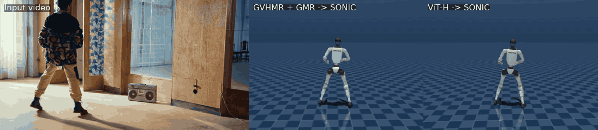
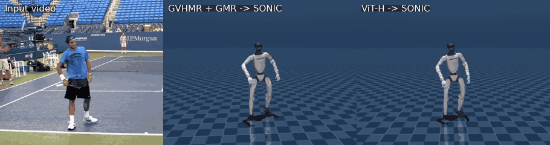
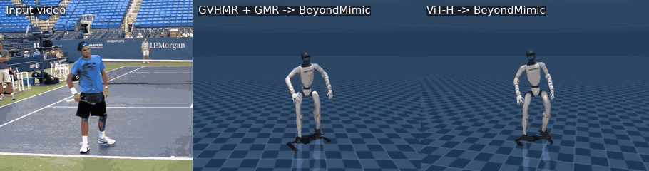

# g1-video2motion

From a video of a person to a Unitree G1 humanoid doing the same motion in simulation. Two ways to
get the motion from video, **GVHMR + GMR** and **ViT-H**, are compared, each tracked by two policies,
**SONIC (ViT-H)** and **BeyondMimic**.

**Studio dance** ([Pexels](https://www.pexels.com/video/a-barefooted-man-dancing-in-a-studio-8377696/))


**Hip-hop** ([Pexels](https://www.pexels.com/video/a-man-dancing-hip-hop-7958174/), cottonbro studio)



**Jump and knee kick** ([Pexels](https://www.pexels.com/video/video-of-man-doing-knee-kick-4806533/)): SONIC (ViT-H) doesn't take off for either motion; BeyondMimic does ViT-H's jump


**Tennis serve** ([GVHMR](https://github.com/zju3dv/GVHMR)'s example video): the GVHMR + GMR motion floats after the jump and fails, ViT-H's finishes



**AIST++ Pop** (robots only: the AIST videos can't be redistributed)


## Results

- **GVHMR + GMR:** 3D human motion from video ([GVHMR](https://github.com/zju3dv/GVHMR)), retargeted
  to the G1 with IK ([GMR](https://github.com/YanjieZe/GMR)).
- **ViT-H:** G1 motion generated straight from video ([ViT-H](https://github.com/mileret/ViT-H-release)).
  It starts from random noise, so each video gets three samples (seeds 42, 1, 2).
- **SONIC (ViT-H):** one tracker for any motion: NVIDIA's [SONIC](https://huggingface.co/nvidia/GEAR-SONIC)
  fine-tuned by ViT-H's authors on BONES-SEED (the data ViT-H learns from), shipped with ViT-H as `g1_tracker`.
- **BeyondMimic:** one policy trained per motion ([mjlab](https://github.com/mujocolab/mjlab)).

Motions are used as they come out: no cleaning, trimming or smoothing. Every run is scored in MuJoCo
by [our fork](https://github.com/amirkhonaripov/g1-eval-harness) of an evaluation harness for the G1:
10 tries on flat ground and 10 under each of 5 harder conditions (low friction, ice, three pushes).

### Video to motion, tracked by SONIC (ViT-H)

| SONIC (ViT-H) | GVHMR + GMR: flat ground | harder | pose error (cm) | ViT-H, 3 samples: flat ground | harder | pose error (cm) |
|---|---|---|---|---|---|---|
| Studio dance (Pexels) | finishes | 50/50 | 7.5 | 3/3 finish | 150/150 | 4.4 |
| Hip-hop (Pexels) | finishes | 49/50 | 11.9 | 3/3 finish | 150/150 | 3.1 |
| Jump and knee kick (Pexels) | fails at 1.0 s | 0/50 | 6.4 | 0/3 finish | 0/150 | 6.1 |
| Tennis serve | fails at 4.5–7.8 s | 0/50 | 6.9 | 2/3 finish | 111/150 | 5.0 |
| AIST++ Pop | finishes | 50/50 | 3.7 | 3/3 finish | 150/150 | 2.4 |
| AIST++ Jazz | finishes | 50/50 | 2.0 | 3/3 finish | 150/150 | 2.8 |

- **Dances work with both methods,** on flat ground and under pushes and ice.
- **SONIC (ViT-H) doesn't jump.** At take-off the reference pelvis rises 23 cm; the robot's stays down, and
  a foot ends up more than 25 cm below the reference ("fails": BeyondMimic's rule, used for every
  tracker). ViT-H's own tracker script fails the same way. A BeyondMimic policy trained on ViT-H's
  motion does the jump (93% in mjlab, 50/50 under harder conditions); on GVHMR + GMR's it can't,
  because that jump keeps rising after take-off, against gravity. Details:
  [`docs/experiments.md`](docs/experiments.md).
- **On the tennis serve, ViT-H does better,** but its samples differ: same video, 2 of 3 finish.
- **ViT-H's motions are easier to track** (lower pose error on 5 of 6 clips) **but break joint
  limits** on up to 13% of frames; GMR's IK keeps them inside. Pose error is measured against each
  method's own motion, so it says how trackable a motion is, not how close it is to the video.
- **GVHMR + GMR's motions float.** On the tennis serve its feet stay 12–20 cm above the floor after
  the jump, which is why it fails. Putting the feet back on the floor (same fix for both methods,
  `scripts/ground_motion.py`) makes it finish 10/10, and ViT-H's samples finish 30/30. Nothing else
  changes. Details: [`docs/experiments.md`](docs/experiments.md).
- **Time to make a motion** on one RTX PRO 5000: GVHMR + GMR 23–97 s, ViT-H 17–43 s per sample.

All results are on the harness's default robot model, `ros2`: the G1 of the ROS 2 stack that runs
the real robot.

### How close the motions are to the real dance

The tables above say how well a robot follows each method's motion, not whether the motion matches
the video. AIST++ recorded the two AIST dances with motion capture, so there we can check: the capture
is retargeted to the G1 with GMR (`scripts/aistpp_to_gvhmr.py`) and compared frame by frame with each
method's motion (`scripts/motion_accuracy.py`, after the best time offset, at most 0.3 s).

| Against motion capture | Pop: GVHMR + GMR | Pop: ViT-H, 3 samples | Jazz: GVHMR + GMR | Jazz: ViT-H, 3 samples |
|---|---|---|---|---|
| Body pose error (cm) | 5.3 | 4.9–6.1 | 5.5 | 4.4–4.8 |
| Joint angle error (°) | 10.4 | 11.3–12.7 | 14.9 | 17.3–17.9 |
| Pelvis height error (cm) | 2.4 | 4.2–5.4 | 3.7 | 2.7–2.9 |
| Path error (cm) | 5.2 | 4.1–6.4 | 3.1 | 1.4–1.9 |
| Heading error (°) | 12.9 | 8.2–9.4 | 2.1 | 1.5–1.8 |

- **Neither method is clearly closer.** Body positions are within 1 cm of each other; ViT-H is a
  bit closer on jazz, GVHMR + GMR on pop's pelvis height.
- **Joint angles favour GVHMR + GMR by construction:** the reference is retargeted by GMR too, so
  for the same body pose it picks the same angles. Body pose error doesn't have that bias.
- **Body pose error:** body positions relative to the pelvis, turned to face the same way. **Path
  and heading:** where the pelvis goes and which way it faces, both aligned at the first frame.
- Two dances, filmed from the front by a fixed camera: a small, easy sample.

### BeyondMimic on the tennis serve

One policy trained per motion (3000 iterations, 4096 environments, ~1 h per policy on one GPU).



| Tennis serve | GVHMR + GMR | ViT-H sample 1 |
|---|---|---|
| BeyondMimic, mjlab (1024 tries) | finishes 97% | finishes 100% |
| BeyondMimic, flat ground | finishes | finishes |
| BeyondMimic, harder conditions | 50/50 | 49/50 |
| BeyondMimic, pose error (cm) | 9.3 | 4.5 |
| SONIC (ViT-H), flat ground | fails at 4.5–7.8 s | finishes |
| SONIC (ViT-H), harder conditions | 0/50 | 49/50 |

- **A policy trained on the motion copes with GVHMR + GMR's floating feet,** where SONIC (ViT-H) doesn't;
  it copies the pose less closely (9.3 vs 4.5 cm on ViT-H's motion).
- **ViT-H's motion is tracked equally well by both** trackers.

### LAFAN1 dance: BeyondMimic vs SONIC (ViT-H)

mjlab's demo motion (131 s of motion capture) and its pretrained BeyondMimic policy.

| | BeyondMimic | SONIC (ViT-H) |
|---|---|---|
| Flat ground | finishes | fails at 106.7 s (cartwheel) |
| Harder conditions | 40/50 | 0/50 |
| Pose error / position error, mean (cm) | 3.5 / 7.6 | 4.2 / 185 |
| Policy time per step (ms, one CPU thread) | 0.05 | 1.34 |
| Policy's own evaluation | mjlab: finishes 93% of 1024; ROS 2 stack: 5/5 | `g1_tracker`: fails at 106.7 s |

- **SONIC (ViT-H) drifts by design:** it follows the motion relative to itself, not a
  fixed world position.

### Sim-to-sim: mjlab vs the ROS 2 deployment stack

The same BeyondMimic policy in mjlab (1024 episodes) and in the ROS 2 stack that runs on the robot
([motion_tracking_controller](https://github.com/HybridRobotics/motion_tracking_controller) +
MuJoCo, 5 runs, mean (min–max)).

| | mjlab | ROS 2 + MuJoCo |
|---|---|---|
| Finishes | 93.1% | 5/5 |
| Joint error, mean (rad) | 0.084 | 0.083 (0.082–0.084) |
| Pose error, mean (cm) | 3.8 | 3.3 (3.3–3.4) |
| Position error, mean (cm) | 10.9 | 28.1 (27.2–28.9) |
| Drift from the reference path, max (m) | 0.33 | 0.75; 0.35 in the estimator's frame |

The policy runs as trained. The larger position error in ROS 2 comes from its state estimator,
which drifts up to ~1 m; measured in the estimator's frame, drift matches mjlab.

All tables (per clip, per sample): [`results/routes/harness_tables.md`](results/routes/harness_tables.md).
What we tested and why: [`docs/experiments.md`](docs/experiments.md).

## Run it on your own video

Needs Ubuntu 24.04 and an NVIDIA GPU. Clone the tools into `third_party/` at these commits and
install each as its README says:

| Tool | Repo | Commit | Notes |
|---|---|---|---|
| GVHMR | [zju3dv/GVHMR](https://github.com/zju3dv/GVHMR) | `ee960bb` | needs SMPL/SMPL-X (free sign-up) |
| GMR | [YanjieZe/GMR](https://github.com/YanjieZe/GMR) | `25f56db` | |
| ViT-H | [mileret/ViT-H-release](https://github.com/mileret/ViT-H-release) as `vit-h` | `2482c5c` | `vith_offline_g1.ckpt`, SAM 3D Body, `g1_tracker` |
| mjlab | [mujocolab/mjlab](https://github.com/mujocolab/mjlab) | `1b5c91c` | `uv sync` |
| Harness | [amirkhonaripov/g1-eval-harness](https://github.com/amirkhonaripov/g1-eval-harness) | `main` | `uv venv && uv pip install -r requirements.txt` |

**1. Video to motion.** The tools expect 30 fps. Add `--static-camera` if the camera doesn't move.

```bash
ffmpeg -i my_clip.mp4 -vf fps=30 -an data/videos/my_clip.mp4
scripts/video_to_motion.sh data/videos/my_clip.mp4 my_clip
```

It writes `data/motions/{gmr,vith}/my_clip*.npz` for BeyondMimic and
`runs/sonic/{gmr,vith}_my_clip*_in.npz` for SONIC (`_s1`, `_s2`: the other ViT-H samples).
If a motion floats or sinks, put its feet back on the floor:

```bash
PY=third_party/mjlab/.venv/bin/python
$PY scripts/ground_motion.py data/motions/gmr/my_clip.npz --output-file data/motions/gmr/my_clip_grounded.npz
$PY scripts/gmr_to_sonic.py data/motions/gmr/my_clip_grounded.npz --output-file runs/sonic/gmr_my_clip_grounded_in.npz
```

**2. Track with SONIC (ViT-H)** (no training):

```bash
cd third_party/g1-eval-harness
.venv/bin/python evaluate.py --adapter adapters.sonic_vith_adapter:SonicVitHAdapter \
  --checkpoint ../vit-h/inputs/checkpoints/g1_tracker/model_step_020000_g1.onnx \
  --set tracker_root=../vit-h/g1_tracker --set motion=../../runs/sonic/gmr_my_clip_in.npz \
  --seeds 0 1 2 3 4 5 6 7 8 9 --output-dir ../../runs/harness/sonic_gmr_my_clip
```

**3. Track with BeyondMimic:** train (~1 h for 3000 iterations on one GPU), export, evaluate.

```bash
PY=third_party/mjlab/.venv/bin/python
TASK=Mjlab-Tracking-Flat-Unitree-G1
MOTION=data/motions/gmr/my_clip.npz
$PY -m mjlab.scripts.train $TASK --env.scene.num-envs 4096 --env.commands.motion.motion-file $MOTION \
  --log-root runs/train --agent.run-name my_clip_gmr
CKPT=$(ls -t runs/train/g1_tracking/*my_clip_gmr/model_*.pt | head -1)
$PY scripts/export_onnx.py $TASK --motion-file $MOTION --checkpoint-file $CKPT \
  --output-file runs/onnx/my_clip_gmr/policy.onnx
$PY scripts/eval_mjlab.py $TASK --motion-file $MOTION --checkpoint-file $CKPT \
  --output-file results/my_clip_gmr.json
cd third_party/g1-eval-harness && .venv/bin/python evaluate.py \
  --adapter adapters.beyondmimic_adapter:BeyondMimicAdapter \
  --checkpoint ../../runs/onnx/my_clip_gmr/policy.onnx --seeds 0 1 2 3 4 5 6 7 8 9
```

`--env.scene.num-envs 4096` matters: mjlab's default is 1 environment, and training on 1 collapses.

**4. Video and GIF.** `render_run.py` films the run from the side the video sees the person
(it needs the GVHMR output of the same video):

```bash
$PY scripts/render_run.py runs/harness/sonic_gmr_my_clip/logs/flat_nominal_seed0.npz --follow \
  --gvhmr-file runs/videos2motion/my_clip/gvhmr/my_clip/hmr4d_results.pt --output-file my_clip_gmr.mp4
scripts/make_gif.sh my_clip.gif data/videos/my_clip.mp4 "GVHMR + GMR -> SONIC (ViT-H)" my_clip_gmr.mp4
$PY scripts/motion_quality.py data/motions/*/my_clip*.npz   # joint limits, speed, foot sliding
```

## Sim-to-sim: run BeyondMimic in the ROS 2 stack

Needs ROS 2 Jazzy as well.

**Demo policy and motion** (the files mjlab's own demo uses):

```bash
curl --create-dirs -o runs/checkpoints/demo/model_49999.pt \
  https://storage.googleapis.com/mjlab_beta/model_49999.pt
curl --create-dirs -o data/motions/demo/lafan1_dance1_subject1.npz \
  https://storage.googleapis.com/mjlab_beta/lafan_dance1_subject1.npz
```

**ROS 2 controller.** Its dependencies are only published in its author's apt repositories:

```bash
for repo in legged unitree simulation; do
  echo "deb [trusted=yes] https://github.com/qiayuanl/${repo}_buildfarm/raw/noble-jazzy-amd64/ ./" \
    | sudo tee /etc/apt/sources.list.d/qiayuanl_${repo}_buildfarm.list
done
# ROS has its own package with the same name; take the one from these repositories
printf 'Package: ros-jazzy-mujoco-ros2-control\nPin: origin github.com\nPin-Priority: 1001\n' \
  | sudo tee /etc/apt/preferences.d/qiayuanl-mujoco
sudo apt update && sudo apt install ros-jazzy-mujoco-sim-ros2 ros-jazzy-rosbag2-storage-mcap

mkdir -p ~/colcon_ws/src && cd ~/colcon_ws/src
git clone https://github.com/HybridRobotics/motion_tracking_controller.git
git clone https://github.com/qiayuanl/unitree_bringup.git
git -C motion_tracking_controller checkout 742924f && git -C unitree_bringup checkout 8a0f308
cd ~/colcon_ws && rosdep install --from-paths src --ignore-src -y
colcon build --symlink-install --packages-up-to motion_tracking_controller unitree_bringup
```

**Run.**

```bash
PY=third_party/mjlab/.venv/bin/python
TASK=Mjlab-Tracking-Flat-Unitree-G1
MOTION=data/motions/demo/lafan1_dance1_subject1.npz
CKPT=runs/checkpoints/demo/model_49999.pt
$PY scripts/eval_mjlab.py $TASK --motion-file $MOTION --checkpoint-file $CKPT \
  --output-file results/demo_policy.json
python3 scripts/summarize_mjlab.py results/demo_policy.json   # when and why episodes failed
$PY scripts/export_onnx.py $TASK --motion-file $MOTION --checkpoint-file $CKPT \
  --output-file runs/onnx/demo/policy.onnx
```

Then, in two terminals with `source /opt/ros/jazzy/setup.bash && source ~/colcon_ws/install/setup.bash`,
start the recorder first (the policy starts with the simulator), then the simulator, and press
Ctrl+C in both when the dance is over (~2.5 min):

```bash
ros2 bag record -s mcap -o runs/bags/run_01 /joint_states /mid360 /odom
```

```bash
ros2 launch motion_tracking_controller mujoco.launch.py policy_path:=$PWD/runs/onnx/demo/policy.onnx
```

Analyse:

```bash
python3 scripts/bag_to_npz.py runs/bags/run_01
$PY scripts/analyze_ros2.py runs/npz/run_01.npz --output results/ros2_demo_runs.json
```

## Credits and licenses

- **This repo:** code under the [MIT License](LICENSE); results, tables, GIFs and docs under
  [CC BY 4.0](https://creativecommons.org/licenses/by/4.0/).
- **Videos** (not in the repo):
  - Pexels clips: [Pexels License](https://www.pexels.com/license/) (free to use and modify).
  - Tennis serve: GVHMR's `docs/example_video/tennis.mp4`, under GVHMR's license (educational,
    research and non-profit use, with attribution).
  - AIST++ Pop and Jazz: [AIST Dance Video Database](https://aistdancedb.ongaaccel.jp/)
    (Tsuchida et al., ISMIR 2019); no redistribution, so only the robots are shown.
- **AIST++ motion capture** (accuracy check): [AIST++](https://google.github.io/aistplusplus_dataset/)
  annotations by Google LLC (Li et al., ICCV 2021), CC BY 4.0; not in the repo.
- **LAFAN1 dance:** Ubisoft La Forge [LAFAN1](https://github.com/ubisoft/ubisoft-laforge-animation-dataset),
  CC BY-NC-ND 4.0, via mjlab's demo.
- **Evaluation harness:** forked from
  [likealiens/g1-eval-harness](https://github.com/likealiens/g1-eval-harness).
- **G1 model:** `unitree_description` 1.3.0, ROS 2 Jazzy package (BSD).
- GVHMR (non-profit), GMR and ViT-H (MIT), mjlab (Apache 2.0) and motion_tracking_controller keep
  their own licenses.
