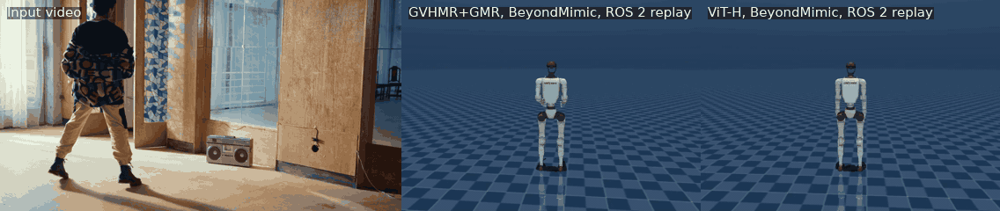
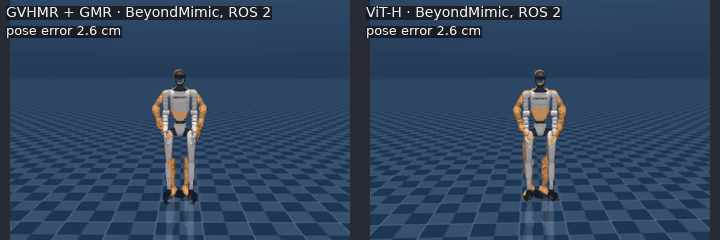
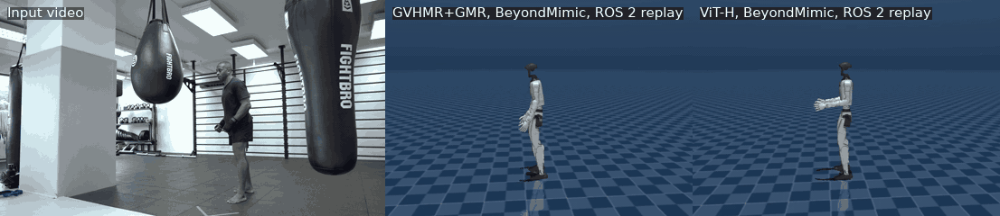
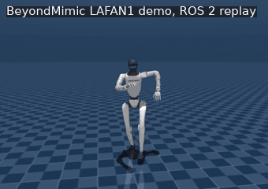
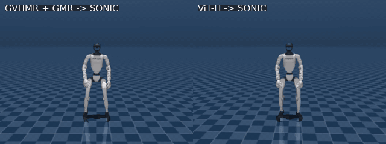

# g1-video2motion

This repo turns ordinary videos of people into motions for the Unitree G1 humanoid, trains BeyondMimic
policies on them (BeyondMimic: HybridRobotics' motion tracker, one small policy per motion) and runs those
policies in HybridRobotics' ROS 2 deployment stack, the controller used on the real robot, here in MuJoCo
("the ROS 2 stack" below). Two SONIC trackers (NVIDIA's motion tracker: one network for any motion, no
training per motion) are scored on the same motions for comparison.

**Contents:** [How it works](#how-it-works) · [Recommendation](#recommendation) · [Results](#results) ·
[Limitations and definitions](#limitations-and-definitions) · [Install](#install) · [Run](#run) ·
[Credits and licenses](#credits-and-licenses)


*Studio dance: BeyondMimic in the ROS 2 stack, replay of a ROS 2 recording. Input video, then the GVHMR + GMR
and ViT-H sample 1 policies side by side.*

## How it works

1. **Make a motion** (both routes): a video becomes a G1 robot motion, in one of two ways:
   - **GVHMR + GMR:** GVHMR rebuilds the person's 3D body motion from the video, as an SMPL-X body model;
     GMR (General Motion Retargeting) maps it onto the G1's joints.
   - **ViT-H** (Video-To-Humanoid, not the ViT-Huge image backbone): a generative model that turns the video
     straight into G1 motion. Each seed gives a different sample; we make 3 per clip.
2. **Check and ground** (both routes): the motion is checked for joint limits, joint speed and foot
   sliding. If it floats, it is grounded: moved down so the feet touch the floor.
3. **Track and score**, by one of two routes:
   - **BeyondMimic route** (the main tracker):
     - one policy is trained per motion in mjlab (a robot-learning framework on MuJoCo, with BeyondMimic's
       training task) and exported to ONNX (the motion is inside the file), or the public pretrained policy
       for the LAFAN1 dance is used instead (LAFAN1: Ubisoft's motion-capture dataset);
     - scored three ways: mjlab's own evaluation, the harness, and the ROS 2 stack
       (`motion_tracking_controller`, ROS 2 Jazzy) in MuJoCo, recorded and scored.
   - **SONIC route** (for comparison):
     - no training: the motion is converted to SONIC's format and fed to the tracker directly;
     - two trackers: SONIC v1.1 (NVIDIA's release) and SONIC (ViT-H), the version fine-tuned by ViT-H's authors;
     - scored in the harness only.
4. **Report** (both routes): one script builds [`results/tables.md`](results/tables.md) from all three
   scorers. Videos and GIFs come from harness logs or ROS 2 recordings.

**The harness** is a separate shared tool: our fork of a G1 evaluation harness, cloned into
`third_party/g1-eval-harness`. It scores every tracker on the same robot body (the ROS 2 stack's G1
model), the same physics, 6 conditions and 10 seeds.

## Recommendation

- **Use BeyondMimic.** On these clips it is the most reliable tracker: 1228/1320 harness trials
  succeed, against 995/1320 for SONIC v1.1 and 1096/1320 for SONIC (ViT-H). It is the only one
  that does the jump kick and the only one that finishes the LAFAN1 dance (50/60; both SONIC 0/60).
- **It runs in the ROS 2 stack.** 236/250 scored ROS 2 runs succeed. They took 389 launches: 139 were
  relaunches after a [start-up drop](#start-up-drops-in-the-ros-2-sim) or a recording that started late.
  All 14 failures are on the jump kick: 10 are the GVHMR + GMR jump kick, which fails everywhere, and 4 are
  ViT-H jump kicks.
- **Its price:** one policy per motion (24–33 min of training each on our GPU; see [Cost](#cost)). When it
  fails, the robot can really fall: 45 of its 92 failed harness trials end in a real fall, all under pushes.
  SONIC's failures on the video clips leave the robot standing.
- **Prefer ViT-H motions.** They track better than GVHMR + GMR motions with every tracker (BeyondMimic
  965/990 vs 263/330). One cause we could show: GVHMR + GMR's tennis serve floats above the floor, and
  grounding it lifts SONIC (ViT-H) from 0/60 to 55/60. ViT-H's 3 samples of one video can differ a lot, so
  check each one. ViT-H motions also go past the G1's joint limits on up to 13% of frames (GVHMR + GMR
  never do), a risk on a real robot.
- **Neither method is closer to the real dance.** Against AIST++ motion capture, their body pose errors
  are within about 1 cm of each other.

## Results

The clips: a tennis serve, a studio dance, hip-hop (filmed from behind), Pop and Jazz from AIST++ (a dance
dataset with motion capture), a jump kick, and the LAFAN1 dance.

Every motion runs in the harness under 6 conditions × 10 seeds = 60 trials: flat ground, low friction,
ice, and three pushes. The jump kick has 30 trials, because it ends before the pushes come.
**Success** = the motion plays to its end without a tracking failure. **r-MPKPE** = pose error on flat
ground. **Real falls** = trials where the robot really ends up on the floor. Exact definitions are in
[Limitations and definitions](#limitations-and-definitions).

Each tracker's harness adapter was first checked against the tracker's own software, so a score
reflects the tracker, not the adapter: BeyondMimic against mjlab and the ROS 2 stack, SONIC v1.1
against NVIDIA's C++ deploy (the same network inputs on every step, within 5e-6), and SONIC (ViT-H)
against ViT-H's own tracker. Details: the harness's
[adapter checks](https://github.com/amirkhonaripov/g1-eval-harness#5-adapter-checks).

ViT-H rows show samples 1 · 2 · 3 of the same video. Full detail per condition, with MPKPE and the
grounded motions: [`results/tables.md`](results/tables.md).

### BeyondMimic

One policy per motion, 3000 iterations. The LAFAN1 dance uses the public pretrained policy.
**mjlab:** mjlab's own evaluation, 1024 episodes. **ROS 2:** the ROS 2 stack, 10 scored runs per policy,
shown as k/n. N in "(N launches)" counts every launch, including the relaunches after
[start-up drops](#start-up-drops-in-the-ros-2-sim). **ROS 2 r-MPKPE:** up to the end or the tracking failure, mean of the
scored runs. **ROS 2 falls:** real falls in the scored runs.

| Clip | Motion | Success | r-MPKPE (cm) | Real falls | mjlab | ROS 2 | ROS 2 r-MPKPE (cm) | ROS 2 falls |
|---|---|---|---|---|---|---|---|---|
| Tennis serve | GVHMR + GMR | 60/60 | 9.3 | 0/60 | 989/1024 | 10/10 (17 launches) | 9.8 | 0/10 |
|  | ViT-H 1 · 2 · 3 | 59/60 · 57/60 · 53/60 | 4.5 · 5.7 · 6.0 | 0/60 · 2/60 · 1/60 | 1023/1024 · 1024/1024 · 1010/1024 | 10/10 · 10/10 · 10/10 (12 · 11 · 16 launches) | 4.3 · 5.2 · 5.6 | 0/10 · 0/10 · 0/10 |
| Studio dance | GVHMR + GMR | 41/60 | 8.0 | 19/60 | 1024/1024 | 10/10 (17 launches) | 9.7 | 0/10 |
|  | ViT-H 1 · 2 · 3 | 57/60 · 59/60 · 60/60 | 4.5 · 5.8 · 4.4 | 3/60 · 1/60 · 0/60 | 1022/1024 · 1024/1024 · 1024/1024 | 10/10 · 10/10 · 10/10 (22 · 15 · 22 launches) | 6.6 · 8.7 · 7.0 | 0/10 · 0/10 · 0/10 |
| Hip-hop | GVHMR + GMR | 52/60 | 12.5 | 0/60 | 1023/1024 | 10/10 (16 launches) | 9.0 | 0/10 |
|  | ViT-H 1 · 2 · 3 | 60/60 · 60/60 · 60/60 | 2.7 · 2.7 · 2.8 | 0/60 · 0/60 · 0/60 | 1023/1024 · 1023/1024 · 1024/1024 | 10/10 · 10/10 · 10/10 (18 · 16 · 12 launches) | 2.8 · 3.0 · 2.9 | 0/10 · 0/10 · 0/10 |
| Pop | GVHMR + GMR | 50/60 | 2.9 | 10/60 | 1024/1024 | 10/10 (16 launches) | 3.6 | 0/10 |
|  | ViT-H 1 · 2 · 3 | 54/60 · 57/60 · 60/60 | 1.7 · 1.8 · 2.8 | 6/60 · 3/60 · 0/60 | 1024/1024 · 1024/1024 · 1023/1024 | 10/10 · 10/10 · 10/10 (13 · 13 · 13 launches) | 2.2 · 2.0 · 3.1 | 0/10 · 0/10 · 0/10 |
| Jazz | GVHMR + GMR | 60/60 | 1.6 | 0/60 | 1024/1024 | 10/10 (18 launches) | 2.5 | 0/10 |
|  | ViT-H 1 · 2 · 3 | 60/60 · 60/60 · 59/60 | 2.0 · 1.8 · 1.9 | 0/60 · 0/60 · 0/60 | 1024/1024 · 1024/1024 · 1024/1024 | 10/10 · 10/10 · 10/10 (19 · 18 · 11 launches) | 2.6 · 2.1 · 2.9 | 0/10 · 0/10 · 0/10 |
| Jump kick | GVHMR + GMR | 0/30 | 7.7 | 0/30 | 0/1024 | 0/10 (14 launches) | 9.9 | 3/10 |
|  | ViT-H 1 · 2 · 3 | 30/30 · 30/30 · 30/30 | 3.4 · 5.1 · 3.5 | 0/30 · 0/30 · 0/30 | 956/1024 · 1011/1024 · 1000/1024 | 9/10 · 8/10 · 9/10 (14 · 11 · 17 launches) | 6.2 · 7.9 · 5.7 | 1/10 · 2/10 · 0/10 |
| LAFAN1 dance | motion capture | 50/60 | 3.5 | 0/60 | 953/1024 | 10/10 (18 launches) | 3.5 | 0/10 |

### SONIC v1.1

NVIDIA's release of SONIC: one tracker for any motion, no training per motion.

| Clip | Motion | Success | r-MPKPE (cm) | Real falls |
|---|---|---|---|---|
| Tennis serve | GVHMR + GMR | 0/60 | 7.4 | 0/60 |
|  | ViT-H 1 · 2 · 3 | 60/60 · 0/60 · 0/60 | 4.5 · 4.1 · 4.8 | 0/60 · 0/60 · 0/60 |
| Studio dance | GVHMR + GMR | 60/60 | 8.3 | 0/60 |
|  | ViT-H 1 · 2 · 3 | 60/60 · 60/60 · 60/60 | 4.5 · 5.4 · 5.0 | 0/60 · 0/60 · 0/60 |
| Hip-hop | GVHMR + GMR | 60/60 | 11.7 | 0/60 |
|  | ViT-H 1 · 2 · 3 | 60/60 · 60/60 · 60/60 | 3.5 · 3.2 · 3.2 | 0/60 · 0/60 · 0/60 |
| Pop | GVHMR + GMR | 60/60 | 3.9 | 0/60 |
|  | ViT-H 1 · 2 · 3 | 60/60 · 60/60 · 35/60 | 3.0 · 2.7 · 3.3 | 0/60 · 0/60 · 0/60 |
| Jazz | GVHMR + GMR | 60/60 | 2.4 | 0/60 |
|  | ViT-H 1 · 2 · 3 | 60/60 · 60/60 · 60/60 | 3.1 · 2.7 · 2.9 | 0/60 · 0/60 · 0/60 |
| Jump kick | GVHMR + GMR | 0/30 | 6.8 | 0/30 |
|  | ViT-H 1 · 2 · 3 | 0/30 · 0/30 · 0/30 | 6.3 · 6.1 · 5.9 | 0/30 · 0/30 · 0/30 |
| LAFAN1 dance | motion capture | 0/60 | 4.1 | 60/60 |

### SONIC (ViT-H)

SONIC fine-tuned by ViT-H's authors on the data ViT-H learns from, shipped with ViT-H.

| Clip | Motion | Success | r-MPKPE (cm) | Real falls |
|---|---|---|---|---|
| Tennis serve | GVHMR + GMR | 0/60 | 6.9 | 0/60 |
|  | ViT-H 1 · 2 · 3 | 59/60 · 34/60 · 44/60 | 4.5 · 5.1 · 5.3 | 0/60 · 0/60 · 0/60 |
| Studio dance | GVHMR + GMR | 60/60 | 7.5 | 0/60 |
|  | ViT-H 1 · 2 · 3 | 60/60 · 60/60 · 60/60 | 3.9 · 5.0 · 4.4 | 0/60 · 0/60 · 0/60 |
| Hip-hop | GVHMR + GMR | 59/60 | 11.9 | 0/60 |
|  | ViT-H 1 · 2 · 3 | 60/60 · 60/60 · 60/60 | 3.2 · 3.0 · 3.1 | 0/60 · 0/60 · 0/60 |
| Pop | GVHMR + GMR | 60/60 | 3.7 | 0/60 |
|  | ViT-H 1 · 2 · 3 | 60/60 · 60/60 · 60/60 | 2.2 · 2.3 · 2.8 | 0/60 · 0/60 · 0/60 |
| Jazz | GVHMR + GMR | 60/60 | 2.0 | 0/60 |
|  | ViT-H 1 · 2 · 3 | 60/60 · 60/60 · 60/60 | 2.9 · 2.7 · 2.7 | 0/60 · 0/60 · 0/60 |
| Jump kick | GVHMR + GMR | 0/30 | 6.4 | 0/30 |
|  | ViT-H 1 · 2 · 3 | 0/30 · 0/30 · 0/30 | 6.1 · 6.0 · 6.2 | 0/30 · 0/30 · 0/30 |
| LAFAN1 dance | motion capture | 0/60 | 4.2 | 60/60 |

### Trackers side by side

Harness success. ViT-H columns add up samples 1–3.

| Clip | BeyondMimic: GVHMR + GMR | BeyondMimic: ViT-H | SONIC v1.1: GVHMR + GMR | SONIC v1.1: ViT-H | SONIC (ViT-H): GVHMR + GMR | SONIC (ViT-H): ViT-H |
|---|---|---|---|---|---|---|
| Tennis serve | 60/60 | 169/180 | 0/60 | 60/180 | 0/60 | 137/180 |
| Studio dance | 41/60 | 176/180 | 60/60 | 180/180 | 60/60 | 180/180 |
| Hip-hop | 52/60 | 180/180 | 60/60 | 180/180 | 59/60 | 180/180 |
| Pop | 50/60 | 171/180 | 60/60 | 155/180 | 60/60 | 180/180 |
| Jazz | 60/60 | 179/180 | 60/60 | 180/180 | 60/60 | 180/180 |
| Jump kick | 0/30 | 90/90 | 0/30 | 0/90 | 0/30 | 0/90 |
| **All six clips** | **263/330** | **965/990** | **240/330** | **755/990** | **239/330** | **857/990** |
| Real falls, all six clips | 29/330 | 16/990 | 0/330 | 0/990 | 0/330 | 0/990 |

- **LAFAN1 dance** (131 s of motion capture): BeyondMimic 50/60. Both SONIC versions 0/60, and the
  robot really falls in every trial (60/60).
- **Real falls with BeyondMimic** all come under pushes on the six clips. The grounded GVHMR + GMR jump kick
  (in [`results/tables.md`](results/tables.md), not in the counts above) also falls without a push: 9/30,
  3 each on flat ground, low friction and ice.
- **Runs in the ROS 2 stack:** BeyondMimic only. The stack is built for BeyondMimic policies.
- ViT-H motions have a lower r-MPKPE than GVHMR + GMR motions on 5 of 6 clips, with every tracker.
  Jazz is the exception.
- ViT-H motions go past the G1's joint limits on 0–13% of frames. GVHMR + GMR motions never do
  ([`results/tables.md`](results/tables.md), "Motion sources").

### How close the motions are to the real dance

The tables above say how well a robot follows each method's motion. They don't say whether the motion
matches the video. AIST++ recorded the Pop and Jazz dances with motion capture, so there we can check.
The capture is retargeted to the G1 with GMR and compared frame by frame with each motion, after the
best time offset (at most 0.3 s).

| Motion | Body pose error (cm) | Joint angle error (°) | Pelvis height error (cm) | Path error (cm) | Heading error (°) |
|---|---|---|---|---|---|
| Pop, GVHMR + GMR | 5.3 | 10.4 | 2.4 | 5.2 | 12.9 |
| Pop, ViT-H sample 1 | 4.9 | 11.6 | 4.2 | 6.4 | 8.9 |
| Pop, ViT-H sample 2 | 5.0 | 11.3 | 4.2 | 5.7 | 9.4 |
| Pop, ViT-H sample 3 | 6.1 | 12.7 | 5.4 | 4.1 | 8.2 |
| Jazz, GVHMR + GMR | 5.5 | 14.9 | 3.7 | 3.1 | 2.0 |
| Jazz, ViT-H sample 1 | 4.4 | 17.3 | 2.9 | 1.6 | 1.5 |
| Jazz, ViT-H sample 2 | 4.8 | 17.5 | 2.7 | 1.9 | 1.8 |
| Jazz, ViT-H sample 3 | 4.6 | 17.9 | 2.8 | 1.4 | 1.6 |

- **Body pose error:** body positions relative to the pelvis, turned to face the same way.
  **Path and heading:** where the pelvis goes and which way it faces, aligned at the first frame.
- **Neither method is clearly closer.** ViT-H is a bit closer on Jazz; GVHMR + GMR on Pop's pelvis height.
- **Joint angles favour GVHMR + GMR by design:** the reference is retargeted by GMR too.
- Two dances, filmed from the front by a fixed camera: a small, easy sample.

### Videos

**BeyondMimic in the ROS 2 stack.** Each GIF is a replay of ROS 2 recordings. For the video clips it shows
the GVHMR + GMR and ViT-H sample 1 policies side by side. The studio dance is at the top.

**Tennis serve** (GVHMR's example video)


**Hip-hop** (Pexels)



**AIST++ Pop** (robots only: the AIST videos can't be shared)


**AIST++ Jazz** (robots only)



**Jump kick** (Pexels). The GVHMR + GMR robot fails and falls.



**LAFAN1 dance** (pretrained policy). A 25 s excerpt of the 131 s dance. This GIF is under LAFAN1's
CC BY-NC-ND 4.0, not this repo's CC BY 4.0.



<details>
<summary><b>In the harness:</b> SONIC (ViT-H) on both motions of each clip, and BeyondMimic on the tennis serve</summary>

In these GIFs "SONIC" means SONIC (ViT-H). Panels: input video, GVHMR + GMR, ViT-H. A panel that freezes
means a tracking failure there.





</details>

### Findings

#### Floating feet

After the tennis serve's jump, GVHMR + GMR's reconstruction leaves the person's feet about 10–15 cm above the floor from about 5 s to the end.
The feet never come back down in the data. A robot standing on the floor can't follow a pose that floats.
Grounding (`scripts/check/ground_motion.py`) follows a slow floor estimate, so short jumps (under 1 s) stay.

| Tennis serve, GVHMR + GMR | As made | Grounded |
|---|---|---|
| SONIC (ViT-H): success | 0/60 | 55/60 |
| SONIC (ViT-H): flat ground | 0/10 | 10/10 |
| SONIC (ViT-H): r-MPKPE (cm) | 6.9 | 5.0 |
| SONIC v1.1: success | 0/60 | 0/60 |

- Grounding fixes SONIC (ViT-H) on the tennis serve.
- It doesn't fix SONIC v1.1. SONIC v1.1 also fails ViT-H samples 2 and 3 of the serve, so floating is not
  its only problem there.
- BeyondMimic, trained on the floating motion, already succeeds (60/60).
- Grounding also lowers SONIC (ViT-H)'s pose error on three other GVHMR + GMR dances: studio dance
  7.5 → 3.5 cm, hip-hop 11.9 → 4.2 cm, Pop 3.7 → 2.5 cm. On Jazz it makes it slightly worse: 2.0 → 2.2 cm.

#### Jump kick

GVHMR + GMR's jump breaks gravity. Once the feet leave the floor, the body can only slow down at g.
So the take-off speed sets how high it can go.

| Jump kick | Take-off speed (m/s) | Rise that speed allows (m) | Rise in the motion (m) |
|---|---|---|---|
| GVHMR + GMR | 1.60 | 0.13 | 0.23 |
| ViT-H, samples 1–3 | 2.21–2.26 | 0.25–0.26 | 0.19–0.23 |

- GVHMR + GMR's motion keeps rising after take-off. No policy can follow it.
- BeyondMimic fails it: 0/30, also when grounded (0/30) and with 18500 iterations (0/30).
- BeyondMimic learns ViT-H's jump: 30/30 for each sample in the harness. In the ROS 2 stack: 9/10, 8/10, 9/10.
- Neither SONIC version jumps. Both fail every motion of this clip at about 1 s, at take-off.

#### More training

Tennis was also trained to 23000 (GVHMR + GMR) and 22500 (ViT-H sample 1) iterations.
3000 iterations is already enough to succeed (harness 60/60 and 59/60, the same as with longer
training), and longer training mainly keeps the robot on the motion's path: flat-ground MPKPE drops
from 57.7 to 19.0 cm (GVHMR + GMR) and from 30.4 to 12.3 cm (ViT-H). In the ROS 2 stack, longer
training doesn't raise success: 9/10 at 23000 iterations against 10/10 at 3000 (GVHMR + GMR), and
10/10 at both 22500 and 3000 (ViT-H).

#### Falls after the motion ends

In the ROS 2 stack the policy keeps running after the last frame of the motion. It has nothing left to
follow, and the robot usually falls. Each recording goes on for about 22–26 s after the last frame.

- **Most policies fall 1–3 s after the last frame:** 167 of the 250 scored runs; 223 of 250 fall
  at some point after the motion.
- **The LAFAN1 policy holds first:** 9 of 10 runs fall, 9–15 s after the last frame.
- **Jazz ViT-H samples 1 and 2** fall 4–7 s after it, and studio dance ViT-H sample 2 within 1 s.
- **Two Jazz policies stay up:** GVHMR + GMR and ViT-H sample 3 were still standing in all 10 runs
  when the recording stopped, 22–26 s after the last frame.

The harness can't see this: its trials end with the motion.

#### Start-up drops in the ROS 2 sim

Sometimes the simulated robot drops before the controllers are up, even in standby. This comes from
the simulator start, not from the policy: the same policies, started from the spawn pose in the harness,
never fail in the first 0.5 s. 139 of 389 launches (about one in three) had to be repeated, after such a
drop or a recording that started late. That is why the ROS 2 column says "k/n (N launches)".

`scripts.ros2.rollouts` detects these drops, launches again by itself and counts the launches.

#### ROS 2 vs mjlab

Outside the jump kick, every 3000-iteration policy and the LAFAN1 policy succeed in all 10 of their ROS 2
runs, in line with mjlab. The one other failure is the tennis GVHMR + GMR policy trained to 23000
iterations: 9/10. On the jump kick:

| Jump kick | mjlab | ROS 2 |
|---|---|---|
| GVHMR + GMR | 0/1024 | 0/10 |
| ViT-H sample 1 | 956/1024 | 9/10 |
| ViT-H sample 1, 18500 iterations | 1022/1024 | 10/10 |
| ViT-H sample 2 | 1011/1024 | 8/10 |
| ViT-H sample 3 | 1000/1024 | 9/10 |

3 of the 4 ViT-H failures come just after the 0.5 s grace period, at 0.56–0.66 s; the fourth at 1.08 s.
This short, fast start is where the ROS 2 stack costs a little: the robot starts from its standby stance,
not from the motion's first frame as in mjlab and the harness, and it reads its base state from a state
estimator. Trained to 18500 iterations, ViT-H sample 1 succeeds in all 10 ROS 2 runs.

### Cost

**Making a motion** (one NVIDIA RTX PRO 5000 Blackwell; [`results/timings.csv`](results/timings.csv)):

| Clip | Length (s) | GVHMR + GMR (s) | ViT-H, per sample (s) |
|---|---|---|---|
| Tennis serve | 10.4 | 49 | 43 |
| Studio dance | 15.8 | 97 | 31 |
| Hip-hop | 6.9 | 51 | 22 |
| Pop | 12.0 | 58 | 43 |
| Jazz | 12.0 | 58 | 44 |
| Jump kick | 2.2 | 23 | 17 |

**Policy time per step** (LAFAN1 dance, ONNX Runtime on one CPU thread of an AMD Ryzen 9 9950X3D;
the policies run at 50 Hz, so a step has 20 ms):

| BeyondMimic | SONIC v1.1 | SONIC (ViT-H) |
|---|---|---|
| 0.05 ms | 4.62 ms | 1.34 ms |

**Training BeyondMimic:** 24–33 min per policy (3000 iterations, 4096 parallel environments, one
RTX PRO 5000 Blackwell). Measured from the first to the last checkpoint on the 10 policies that were
trained one per GPU; policies that shared a GPU with other jobs took longer. The SONIC trackers need no
training per motion.

## Limitations and definitions

- **Success:** the motion plays to its end without a tracking failure.
- **Tracking failure:** BeyondMimic's termination rule fires. The torso height or a hand or foot height
  is more than 0.25 m off the reference, or the torso tilts too far. The trial stops there.
- **Real fall:** we rerun failed conditions and keep going after the tracking failure. A real fall is when
  the head stays below 0.5 m for more than 2 s, or is still down when the motion ends.
- **MPKPE / r-MPKPE:** mean distance (cm) of 14 key bodies from the reference, over the 10 flat-ground
  trials, up to the end or the tracking failure. MPKPE uses world positions, so it includes drift.
  r-MPKPE places the reference on the robot first, so it measures the pose only.
  SONIC follows the motion relative to itself, so its MPKPE grows on long motions.
- **k/n:** k of n trials. mjlab: episodes. ROS 2: scored runs.
- **Pose error is measured against each method's own motion,** not against the video. It says how
  trackable a motion is, not how true it is.
- **Privileged state:** in the harness, BeyondMimic and SONIC (ViT-H) read the true base position. On the
  robot it comes from a state estimator. SONIC v1.1 reads only the IMU and the joints.
- **Robot model:** all harness results use the G1 model of the ROS 2 stack (`unitree_description` 1.3.0).
- **Pretrained policies:** only one public pretrained BeyondMimic policy exists (the LAFAN1 dance).
  All the others were trained here, at 3000 iterations.
- **ROS 2 runs:** 10 scored runs per policy. The termination rules are checked from 0.5 s on, while the
  robot moves from its standby stance onto the motion.
- **Small sample:** 6 video clips, 2 of them with motion capture.

## Install

For Ubuntu 24.04. Everything below is installed once.

**What you need first:**

- **Hardware:** an x86-64 PC with an NVIDIA GPU. The ROS 2 stack's packages are built for x86-64 only.
  Training (step 2a) uses the most GPU memory; with less memory, lower `--num-envs`.
- **SMPL and SMPL-X:** free registration at [smpl.is.tue.mpg.de](https://smpl.is.tue.mpg.de/) and
  [smpl-x.is.tue.mpg.de](https://smpl-x.is.tue.mpg.de/), one for each, to download the body models
  (non-commercial use).
- **Hugging Face:** an account, approved access to the gated SAM 3D Body model (request it on
  [its model page](https://huggingface.co/facebook/sam-3d-body-dinov3); the authors approve requests by
  hand), and an access token for `hf auth login`.

| Tool | What it does | Needed for |
|---|---|---|
| GVHMR, GMR, ViT-H | make motions from videos | both routes |
| mjlab | trains and scores BeyondMimic policies; also the one environment for this repo's scripts and the harness | BeyondMimic route |
| GR00T-WholeBodyControl | SONIC v1.1 | SONIC route |
| ViT-H's tracker (`g1_tracker`, ships with ViT-H) | SONIC (ViT-H) | SONIC route |
| Harness | scores every tracker the same way | both routes |
| ROS 2 Jazzy and `motion_tracking_controller` | runs policies in the ROS 2 stack | BeyondMimic route only |

**System tools.** `ffmpeg` converts videos and makes GIFs; `uv` installs mjlab.

```bash
sudo apt install ffmpeg git curl
curl -LsSf https://astral.sh/uv/install.sh | sh
```

`hf` is Hugging Face's command-line tool. Install it in a new terminal, once `uv` is on the path:

```bash
uv tool install huggingface_hub
```

**Clone the repo and the tools:**

```bash
git clone https://github.com/amirkhonaripov/g1-video2motion.git
cd g1-video2motion
mkdir third_party
cd third_party
git clone https://github.com/zju3dv/GVHMR.git
git -C GVHMR checkout ee960bb
git clone https://github.com/YanjieZe/GMR.git
git -C GMR checkout 25f56db
git clone https://github.com/mileret/ViT-H-release.git vit-h
git -C vit-h checkout 2482c5c
git clone https://github.com/mujocolab/mjlab.git
git -C mjlab checkout 1b5c91c
git clone https://github.com/NVlabs/GR00T-WholeBodyControl.git
git -C GR00T-WholeBodyControl checkout 1e1ec4f
git clone https://github.com/amirkhonaripov/g1-eval-harness.git
git -C g1-eval-harness checkout 2b3f676
cd ..
```

### GVHMR, GMR and ViT-H

Install each in its own environment, as its own README says: GVHMR's `docs/INSTALL.md` (conda), GMR's
README (`uv sync`), ViT-H's README (conda, plus Fast-SAM-3D-Body in `third-party/`). They pin different
PyTorch versions, so they can't share one environment.

Step 1a runs each tool with `third_party/<tool>/.venv/bin/python`. If you used conda, pass the environment's
Python instead, for example `--gvhmr-python ~/miniconda3/envs/gvhmr/bin/python` (also `--gmr-python`,
`--vith-python`).

**Local fixes.** Apply our small fixes to GVHMR and ViT-H:

```bash
git -C third_party/GVHMR apply ../../patches/gvhmr.patch
git -C third_party/vit-h apply ../../patches/vith.patch
```

They load the camera track with `weights_only=False` (PyTorch 2.6 changed the default), handle newer pycolmap (we used 4.2.1)
returning no camera motion, and drop an unused `from turtle import forward` that fails without Tk. The first
two matter only for videos with a moving camera.

**Models.** SMPL and SMPL-X are free after sign-up at [smpl.is.tue.mpg.de](https://smpl.is.tue.mpg.de/)
and [smpl-x.is.tue.mpg.de](https://smpl-x.is.tue.mpg.de/) (non-commercial use). Put the files here:

```text
third_party/GVHMR/inputs/checkpoints/body_models/smpl/SMPL_{NEUTRAL,MALE,FEMALE}.pkl
third_party/GVHMR/inputs/checkpoints/body_models/smplx/SMPLX_{NEUTRAL,MALE,FEMALE}.npz
third_party/GMR/assets/body_models/smplx/SMPLX_{NEUTRAL,MALE,FEMALE}.pkl
third_party/vit-h/inputs/checkpoints/body_models/smpl/SMPL_{NEUTRAL,MALE,FEMALE}.pkl
third_party/vit-h/inputs/checkpoints/body_models/smplx/SMPLX_{NEUTRAL,MALE,FEMALE}.npz
```

GVHMR's own checkpoints (`gvhmr`, `hmr2`, `vitpose`, `yolo`, `dpvo`) come from the Google Drive folder in
its `docs/INSTALL.md` and go into `third_party/GVHMR/inputs/checkpoints/`.

ViT-H's checkpoint, the `g1_tracker` checkpoint for SONIC (ViT-H), and SAM 3D Body. SAM 3D Body is gated:
request access on [its Hugging Face page](https://huggingface.co/facebook/sam-3d-body-dinov3), and once it
is approved, run `hf auth login` with an access token from your Hugging Face settings.

```bash
cd third_party/vit-h
hf download eerrr1/ViT-H-checkpoints vith_offline_g1.ckpt \
  inputs/checkpoints/hmr2/epoch=10-step=25000.ckpt \
  inputs/checkpoints/vitpose/vitpose-h-multi-coco.pth \
  inputs/checkpoints/yolo/yolov8x.pt \
  --repo-type dataset --local-dir .
hf download eerrr1/ViT-H-checkpoints model_step_020000_g1.onnx \
  --repo-type dataset --local-dir inputs/checkpoints/g1_tracker
hf download facebook/sam-3d-body-dinov3 \
  --local-dir third-party/Fast-SAM-3D-Body/checkpoints/sam-3d-body-dinov3
cd ../..
```

### Our environment (mjlab's)

All of this repo's scripts and the harness run in mjlab's environment:

```bash
cd third_party/mjlab && uv sync && cd ../..
uv pip install --python third_party/mjlab/.venv/bin/python rosbags mcap -r third_party/g1-eval-harness/requirements.txt
```

Activate it once in each new terminal, from the repo root:

```bash
source third_party/mjlab/.venv/bin/activate
```

### SONIC v1.1

Our results use revision `6733128a` of `nvidia/GEAR-SONIC` on Hugging Face. GR00T-WholeBodyControl's own
script downloads the latest files (`python download_from_hf.py --sonic-v1-1 --no-planner`, run in
`third_party/GR00T-WholeBodyControl`); to get exactly that revision:

```bash
hf download nvidia/GEAR-SONIC sonic_v1_1/model_encoder.onnx sonic_v1_1/model_decoder.onnx \
  sonic_v1_1/observation_config.yaml --revision 6733128a \
  --local-dir third_party/GR00T-WholeBodyControl/gear_sonic_deploy/policy
```

### ROS 2 Jazzy and the ROS 2 stack (BeyondMimic route only)

Install ROS 2 Jazzy from the [official instructions](https://docs.ros.org/en/jazzy/Installation/Ubuntu-Install-Debs.html)
(`ros-jazzy-desktop` and `ros-dev-tools`), then:

```bash
sudo rosdep init && rosdep update
```

The stack's dependencies are only published in its author's apt repositories, with rosdep lists to match:

```bash
for repo in legged unitree simulation; do
  echo "deb [trusted=yes] https://github.com/qiayuanl/${repo}_buildfarm/raw/noble-jazzy-amd64/ ./" \
    | sudo tee /etc/apt/sources.list.d/qiayuanl_${repo}_buildfarm.list
  echo "yaml https://github.com/qiayuanl/${repo}_buildfarm/raw/noble-jazzy-amd64/local.yaml jazzy" \
    | sudo tee /etc/ros/rosdep/sources.list.d/1-qiayuanl_${repo}_buildfarm.list
done
# ROS has its own package with the same name; take the one from these repositories
printf 'Package: ros-jazzy-mujoco-ros2-control\nPin: origin github.com\nPin-Priority: 1001\n' \
  | sudo tee /etc/apt/preferences.d/qiayuanl-mujoco
sudo apt update && sudo apt install ros-jazzy-mujoco-sim-ros2 ros-jazzy-rosbag2-storage-mcap \
  ros-jazzy-unitree-description ros-jazzy-unitree-systems
rosdep update

mkdir -p ~/colcon_ws/src && cd ~/colcon_ws/src
git clone https://github.com/HybridRobotics/motion_tracking_controller.git
git clone https://github.com/qiayuanl/unitree_bringup.git
git -C motion_tracking_controller checkout 742924f && git -C unitree_bringup checkout 8a0f308
cd ~/colcon_ws && rosdep install --from-paths src --ignore-src -r -y
colcon build --symlink-install --packages-up-to motion_tracking_controller unitree_bringup
```

These apt repositories aren't pinned the way the git commits above are: `apt install` gets whatever they
hold at the time.

Source ROS 2 and the workspace in every terminal:

```bash
echo "source /opt/ros/jazzy/setup.bash" >> ~/.bashrc
echo "source ~/colcon_ws/install/setup.bash" >> ~/.bashrc
```

## Run

Run every command from the repo root. In each new terminal, activate our environment first:
`source third_party/mjlab/.venv/bin/activate` (ROS 2 is sourced from `~/.bashrc`). Our scripts run as
`python -m scripts.…` because they share `scripts/g1.py`.

The examples use a video `my_clip.mp4`. Every result is named after its motion: `my_clip_gmr` (GVHMR + GMR),
`my_clip_vith_s2` (ViT-H sample 2), `my_clip_gmr_grounded` (a grounded motion). Each helper prints the
commands it runs underneath (`[run] ...`), so you can see and rerun any of them by hand.

| You have | Do |
|---|---|
| A video | 1a → 1c → 2 → 3 → 4 → 5 |
| A motion file | 1b → 1c → 2 → 3 → 4 → 5 |
| A BeyondMimic policy: your own `.pt` or `.onnx`, or the pretrained LAFAN1 policy | 2c → 3 → 4 → 5 |

Step 4 is for BeyondMimic only.

### 1. Get a motion (both trackers)

#### 1a. From a video

Turns a video into G1 motions with GVHMR + GMR or with ViT-H. Input: `my_clip.mp4`. Output:
`data/motions/gmr/my_clip.npz`, or `data/motions/vith/my_clip.npz`, `my_clip_s2.npz` and `my_clip_s3.npz`
(ViT-H samples 1–3; seeds 42, 1, 2). A video that isn't 30 fps is first converted to a 30 fps copy,
`data/videos/my_clip.mp4`. Intermediate files: `runs/videos2motion/my_clip/`. Add `--moving-camera` if the
camera moves, and `--name` for another name than the video's.

```bash
python -m scripts.motion.from_video my_clip.mp4 --method gvhmr_gmr
python -m scripts.motion.from_video my_clip.mp4 --method vith --samples 3
```

**Good input videos:**

- one person;
- the whole body, feet included, in frame all the time (clips where the feet leave the frame don't work well);
- a still camera works best; if it moves, add `--moving-camera`;
- ideally 30 fps or more (GVHMR, GMR and ViT-H work at 30 fps; other frame rates are converted);
- a few seconds to a minute long.

#### 1b. From a motion file

Put a G1 motion in mjlab's format at `data/motions/<method>/<name>.npz`, for example
`data/motions/gmr/my_clip.npz`. That is an `.npz` as written by mjlab's `csv_to_npz`, with `fps`,
`joint_pos`, `joint_vel`, `body_pos_w`, `body_quat_w`, `body_lin_vel_w` and `body_ang_vel_w`. A GMR `.pkl`
converts with `python -m scripts.motion.gmr_to_npz my_clip.pkl --output-file data/motions/gmr/my_clip.npz`.

#### 1c. Check it, and ground it if it floats

Checks motions for joint limits, joint speed, foot sliding and floating. Input: motion files. Output: one
line per motion, ending in `floats: yes` or `floats: no`; add `--output results/motion_quality.json` to
save the results. A motion floats when both feet stay at least 5 cm above the floor without moving up or down (standing in
the air, not jumping) for 0.5 s or more; the line then gives the longest such stretch and its height.

```bash
python -m scripts.check.motion_quality data/motions/gmr/my_clip.npz data/motions/vith/my_clip.npz
```

If a motion floats, ground it: this moves it down so the feet touch the floor (jumps shorter than 1 s stay).
Input: `data/motions/gmr/my_clip.npz`. Output: `data/motions/gmr/my_clip_grounded.npz`, used like any other
motion in the next steps.

```bash
python -m scripts.check.ground_motion data/motions/gmr/my_clip.npz
```

**Optional, Pop and Jazz only: accuracy against AIST++.** Compares the motions of the AIST++ Pop and
Jazz videos with AIST++ motion capture. Input: the AIST++ annotations and `data/motions/<method>/pop.npz`
and `jazz.npz`. Output: `results/motion_accuracy.json`.

Download the AIST++ motion annotations into `data/aistpp/`
([AIST++](https://google.github.io/aistplusplus_dataset/download.html)). Convert the capture to
GVHMR's format, retarget it with GMR, then compare. The first step uses GMR's environment (it needs `smplx`).

```bash
mkdir -p runs/aistpp data/motions/aistpp
third_party/GMR/.venv/bin/python -m scripts.motion.aistpp_to_gvhmr \
  data/aistpp/motions/gPO_sBM_cAll_d10_mPO0_ch01.pkl --output-file runs/aistpp/pop.pt
cd third_party/GMR
.venv/bin/python scripts/gvhmr_to_robot.py --gvhmr_pred_file ../../runs/aistpp/pop.pt \
  --robot unitree_g1 --save_path ../../runs/aistpp/pop_gmr.pkl
cd ../..
python -m scripts.motion.gmr_to_npz runs/aistpp/pop_gmr.pkl --output-file data/motions/aistpp/pop.npz
python -m scripts.check.motion_accuracy
```

Jazz is `gJS_sBM_cAll_d01_mJS0_ch01.pkl`.

### 2. Get a tracker for the motion

#### 2a. BeyondMimic: train a policy

Trains one policy on the motion in mjlab (3000 iterations by default), exports it to ONNX and scores it
with mjlab's own evaluation (1024 episodes). Input: `data/motions/gmr/my_clip.npz`. Output:

- the training run: `runs/train/g1_tracking/<date>_my_clip_gmr/`;
- the policy: `runs/onnx/my_clip_gmr/policy.onnx`, with `reference.npz` (the motion inside the policy)
  next to it;
- the mjlab score: `results/mjlab/my_clip_gmr.json`.

```bash
python -m scripts.beyondmimic.train data/motions/gmr/my_clip.npz
```

`--num-envs` sets the parallel environments (default 4096); lower it if training runs out of GPU memory.
`--iterations` sets the training length.

#### 2b. SONIC: nothing to train

Both SONIC versions were downloaded at [Install](#install). They take the motion directly in step 3.

#### 2c. Bring a BeyondMimic policy

**Your own `.pt`** from mjlab's tracking task (`Mjlab-Tracking-Flat-Unitree-G1`). Exports it with its
motion to `runs/onnx/my_policy/policy.onnx` and `reference.npz`. For its mjlab score
(`results/mjlab/my_policy.json`), run `eval_mjlab` with the same flags.

```bash
python -m scripts.beyondmimic.export_onnx --checkpoint-file my_policy.pt \
  --motion-file data/motions/gmr/my_clip.npz --name my_policy
python -m scripts.beyondmimic.eval_mjlab --checkpoint-file my_policy.pt \
  --motion-file data/motions/gmr/my_clip.npz --name my_policy
```

**Your own `.onnx`** exported from mjlab's tracking task: copy it to `runs/onnx/<name>/policy.onnx`. Step 3
works with it as it is. Step 4 doesn't: recording and scoring ROS 2 rollouts needs the motion's
`reference.npz` next to the policy, and only `export_onnx` writes that file. If you have the `.pt`, export it
as above instead.

**The pretrained LAFAN1 policy.** Downloads the checkpoint and its motion, then exports them. Output:
`runs/onnx/lafan1_dance/policy.onnx` and `reference.npz`.

```bash
curl --create-dirs -o runs/checkpoints/lafan1_dance/model_49999.pt \
  https://storage.googleapis.com/mjlab_beta/model_49999.pt
curl --create-dirs -o data/motions/demo/lafan1_dance1_subject1.npz \
  https://storage.googleapis.com/mjlab_beta/lafan_dance1_subject1.npz
python -m scripts.beyondmimic.export_onnx --checkpoint-file runs/checkpoints/lafan1_dance/model_49999.pt \
  --motion-file data/motions/demo/lafan1_dance1_subject1.npz --name lafan1_dance
```

### 3. Evaluate in the harness (all trackers)

The harness runs every tracker on the G1 model from the ROS 2 stack, the robot body the deployed policy
meets, in plain MuJoCo, under 6 conditions × 10 seeds. Every tracker gets the same body and the same
disturbances, which is what makes the comparison fair. It is our fork of a shared harness, cloned at
[Install](#install).

```bash
python -m scripts.harness beyondmimic my_clip_gmr
python -m scripts.harness sonicv11 data/motions/gmr/my_clip.npz
python -m scripts.harness sonicvith data/motions/gmr/my_clip.npz
```

BeyondMimic takes a policy name (`runs/onnx/<name>/policy.onnx`) or a path to an `.onnx`. The SONIC trackers
take a motion; it is converted to SONIC's format first, into `data/motions/sonic/my_clip_gmr.npz`.

Output, for example for `beyondmimic my_clip_gmr`:

- `runs/harness/beyondmimic_my_clip_gmr__all/summary.md`: the results table (read this first), with
  `summary.json`, per-step logs in `logs/` and videos of the first seed of each condition in `videos/`;
- `runs/harness_falls/beyondmimic_my_clip_gmr__all/`: the conditions with a tracking failure, run again
  without stopping at the failure, to count real falls.

`--seeds` sets the seeds (default `0 1 2 3 4 5 6 7 8 9`). `--no-falls` skips the real-fall reruns.

Our SONIC results were converted from GMR's 30 fps output instead of the 50 fps motion file. Both give the
same results: on Pop, the same outcomes and MPKPE within 1 cm.

The harness can also be run directly with `third_party/g1-eval-harness/evaluate.py`; see
[its README](https://github.com/amirkhonaripov/g1-eval-harness#2-evaluate-a-policy---one-command).

### 4. BeyondMimic in the ROS 2 stack

This runs the policy in HybridRobotics' own robot software, the same controller as on the real robot, with
its own simulator. The harness can't drive that software, so the rollouts are recorded and scored
afterwards with the same rules. It is BeyondMimic only, because that stack runs BeyondMimic policies
(SONIC's equivalent is NVIDIA's separate C++ deploy).

```bash
python -m scripts.ros2.rollouts my_clip_gmr --runs 10
```

- Each rollout opens the MuJoCo viewer, and each launch stops by itself after the motion ends.
- If the robot drops before the policy starts, that launch is thrown away and relaunched automatically.
  The relaunches are counted and show up as "(N launches)" in the tables.
- The recordings go to `runs/bags/`. Run the command again to add more rollouts; they are numbered after
  the existing ones, and the score covers all of them.
- Output: one line per rollout, a summary line (successes, falls and launches) and
  `results/ros2/my_clip_gmr.json`.

`rollouts` uses `scripts/ros2/record.launch.py`, which starts the stack and records it.

To just watch once, without recording, run the stack's own launch file:

```bash
ros2 launch motion_tracking_controller mujoco.launch.py policy_path:=$PWD/runs/onnx/my_clip_gmr/policy.onnx
```

To score existing recordings again (no ROS 2 needed):

```bash
python -m scripts.ros2.analyze_ros2 runs/bags/my_clip_gmr_r*/
```

### 5. Results

**Tables.** Builds the results tables from everything under `runs/harness/`, `runs/harness_falls/`,
`results/mjlab/` and `results/ros2/`. A missing folder only leaves out its part. Output:
[`results/tables.md`](results/tables.md); `--output` writes another file.

```bash
python -m scripts.report.harness_tables
python -m scripts.report.harness_tables --match 'my_clip*'
```

`--match` builds the tables for just the names that match, into `results/tables_<pattern>.md`
(`results/tables_my_clip.md` here). Rerunning a step under the same name replaces
the old result, so give a new experiment a new name with `--name`, for example
`python -m scripts.beyondmimic.train data/motions/gmr/my_clip.npz --iterations 10000 --name my_clip_gmr_10000`.

**Videos.** Renders a ROS 2 recording or a harness log, then puts it next to the input video. Input: a
recording (`runs/bags/my_clip_gmr_r1/`) or a harness log (`runs/harness/<run>/logs/<scenario>_seed<n>.npz`).
Output: `my_clip_gmr.mp4`, then `my_clip.gif`. The input video is the 30 fps copy from step 1a, or
`my_clip.mp4` itself if it was already 30 fps. Give `-` instead of the input video to leave it out.

```bash
python -m scripts.report.render_run runs/bags/my_clip_gmr_r1 --output-file my_clip_gmr.mp4
bash scripts/report/make_gif.sh my_clip.gif data/videos/my_clip.mp4 "BeyondMimic, ROS 2" my_clip_gmr.mp4
```

## Credits and licenses

- **This repo:** code under the [MIT License](LICENSE); results, tables, GIFs and docs under
  [CC BY 4.0](https://creativecommons.org/licenses/by/4.0/), unless a source below sets other terms.
- **Videos** (not in the repo):
  - Pexels clips, under the [Pexels License](https://www.pexels.com/license/) (free to use and modify):
    [studio dance](https://www.pexels.com/video/a-barefooted-man-dancing-in-a-studio-8377696/) by PNW Production,
    [hip-hop](https://www.pexels.com/video/a-man-dancing-hip-hop-7958174/) by cottonbro studio,
    [jump kick](https://www.pexels.com/video/video-of-man-doing-knee-kick-4806533/) by Ketut Subiyanto.
  - Tennis serve: GVHMR's `docs/example_video/tennis.mp4`, under GVHMR's license (educational, research
    and non-profit use, with attribution). The tennis GIFs contain frames of it, so the same terms apply to them.
  - AIST++ Pop and Jazz: [AIST Dance Video Database](https://aistdancedb.ongaaccel.jp/)
    (Tsuchida et al., ISMIR 2019). No redistribution, so only the robots are shown.
- **AIST++ motion capture** (accuracy check): [AIST++](https://google.github.io/aistplusplus_dataset/)
  annotations by Google LLC (Li et al., ICCV 2021), CC BY 4.0; not in the repo.
- **LAFAN1 dance:** Ubisoft La Forge [LAFAN1](https://github.com/ubisoft/ubisoft-laforge-animation-dataset),
  CC BY-NC-ND 4.0, via mjlab's demo. `results/gifs/ros2_lafan1_dance.gif` shows this motion, so it is under
  CC BY-NC-ND 4.0, not CC BY 4.0.
- **SMPL-X** body model ([SMPL-X](https://smpl-x.is.tue.mpg.de/), Max Planck Institute for Intelligent
  Systems; non-commercial research license): used by GVHMR, GMR and ViT-H to make the motions and by the
  AIST++ check; not in the repo.
- **Evaluation harness:** [our fork](https://github.com/amirkhonaripov/g1-eval-harness) of
  [likealiens/g1-eval-harness](https://github.com/likealiens/g1-eval-harness).
- **G1 model:** `unitree_description` 1.3.0, ROS 2 Jazzy package (BSD).
- **Trackers and tools:** NVIDIA [GEAR-SONIC](https://huggingface.co/nvidia/GEAR-SONIC)
  (code Apache 2.0, weights NVIDIA Open Model License); [ViT-H](https://github.com/mileret/ViT-H-release)
  (MIT) and its SONIC fine-tune; [GVHMR](https://github.com/zju3dv/GVHMR) (non-profit);
  [GMR](https://github.com/YanjieZe/GMR) (MIT); [mjlab](https://github.com/mujocolab/mjlab) (Apache 2.0);
  HybridRobotics' [motion_tracking_controller](https://github.com/HybridRobotics/motion_tracking_controller)
  (its `LICENCE` file is MIT; its `package.xml` says Apache-2.0).
  Each keeps its own license.
